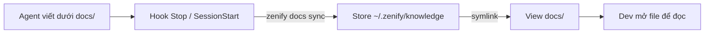

# Knowledge store và view `docs/`

## Tổng quan

Spec, plan, handoff và release report là record của cả team. Workspace root không phải một git repo, nên không ai `git pull` được chúng. Trước đây các file này nằm rải rác trên máy của một người.

Knowledge store là một git repo riêng, private, giữ toàn bộ record đó ở một nơi ai cũng đọc được. Store đồng bộ tự động. Không ai phải tự merge hay clone.

## Cách hoạt động

*Đường đi của một record từ agent đến người đọc*

Store thật nằm ở `~/.zenify/knowledge`, theo quy ước như `~/.npm` hay `~/.m2`: ẩn ở home dir, không nằm trong workspace. `docs/` trong workspace là thư mục thật. Sáu dir của store (`specs/ plans/ handoff/ reference/ releases/ agent-memory/`) là symlink trỏ vào store; năm dir local (`research/ notes/ scripts/ exports/ external/`) là thư mục thật nằm cạnh, không git, không sync. Đọc và ghi qua `docs/specs/...` vẫn hoạt động bình thường vì đi xuyên symlink. Cách viết spec/plan không đổi.

Agent là writer duy nhất. Mỗi lượt (hook `Stop`) và lúc mở phiên (`SessionStart`) đều gọi `zenify docs sync`. Lệnh này commit, `pull --rebase`, rồi push `main` của store. Khi rebase xung đột ở một commit chỉ đổi dòng `**Trạng thái:**` của spec (do `docs sweep` ghi), commit đó bị bỏ, bên remote thắng, và note ghi rõ commit nào đã bỏ; xung đột ở nội dung khác thì hủy rebase, giữ nguyên commit local. Lệnh fail-open: lỗi mạng không chặn phiên làm việc. Dev không `git clone` hay chạy git trong store. Dev chỉ mở file qua `docs/...` trong editor.

## Liên quan

- [Ba lớp: binary, plugin, knowledge store](/concepts/three-layers): knowledge store là lớp thứ ba.
- [Gate fail-open](/concepts/gate-fail-open): `docs sync` cũng fail-open theo cùng nguyên tắc với gate.
- [Quy ước thư mục workspace](/concepts/workspace-layout): mười một tên dưới `docs/`, file nào nằm đâu và ai dọn.

## Lưu ý

- File tracked trong store là 0644; kit không chmod, guardrail là quy ước không sửa tay.
- `zenify docs sweep` dọn file hết giá trị khỏi store (mặc định chỉ in kế hoạch, `--apply` mới xóa) và `zenify wt sweep` tự gọi nó. Xem [Quy ước thư mục workspace](/concepts/workspace-layout).
- Không chạy git trực tiếp trong store: không PR, không merge, không clone tay. Toàn bộ vòng đời do `zenify docs sync` quản lý.
- Máy chưa migrate (chưa có `~/.zenify/knowledge`, chưa có `docs/` cũ): hàm resolve dùng workspace `docs/` như bản cũ. Vẫn hoạt động, chỉ chưa ở layout mới. Máy hoàn toàn mới: kit clone thẳng vào `~/.zenify/knowledge` và nhận layout mới, không cần migrate tay.
