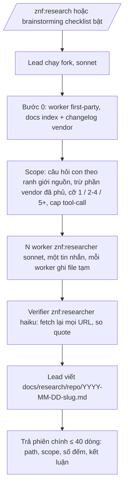

# Research có kiểm chứng: khi nào, luồng, chi phí

## Vì sao có skill riêng

Trong 30 ngày đo trên một workspace, agent research được dispatch 66 lần, lần nào cũng viết prompt tay, không lần nào có bước kiểm lại URL. Kết quả là claim ngoài codebase đi vào spec mà không ai fetch được nguồn, lỗi "nhớ chắc nhưng đã lỗi thời" không bị bắt, và báo cáo dài trả thẳng vào phiên chính rồi mất sau `/clear`.

`znf:research` chuẩn hoá ba điểm đó: hợp đồng output có quote nguyên văn và URL đã fetch, một lượt verify tách riêng, và kết quả là file local trong `docs/research/<repo>/`; chỉ khi một spec trỏ tới thì file được chuyển sang store (`docs/reference/<repo>/`).

## Khi nào chạy — checklist sáu mục

Brainstorming chạy checklist một lần sau khi hỏi làm rõ, trước khi đề xuất phương án. Một mục đúng là gọi research; không mục nào thì bỏ qua và không viết mục "prior art" cho có.

1. Thiết kế phụ thuộc thư viện / framework / tool / API ngoài mà session chưa đọc docs.
2. Thiết kế dựa vào "người khác làm X thế nào".
3. Có sự thật dễ lỗi thời: latest, version, giá, release note, sau knowledge cutoff.
4. Có từ hai phương án thật sự khác nhau mà chọn sai tốn hơn một lượt research (~5 USD).
5. Thiết kế dựng hạ tầng quanh một tool bên thứ ba (runner, queue, session, giới hạn seat trên agent CLI, code host, tracker) → luôn đúng với loại thiết kế này.
6. Ngược lại: điều chưa biết nằm trong repo hoặc DB → `/znf:ground` hoặc `/znf:scout`, không research.

Số liệu đằng sau: 9 trong 88 spec của một team cần research, toàn bộ là việc thiết kế tool và quy trình. Feature sản phẩm hầu như không cần, nên đây là bước có điều kiện, không phải bước cố định.

## Bước 0: kiểm tra first-party

Trước khi tách câu hỏi con, lead dispatch một worker riêng (`worker-0.md`) hỏi đúng một câu: vendor của tool mình đang dựng lên trên đã ship tính năng này chưa? Với mỗi tool/platform thiết kế dựa vào (Claude Code, GitHub, tracker…), worker fetch docs index (`llms.txt`, không có thì sitemap) và changelog 6 tháng gần nhất, tìm theo từ khoá năng lực (runner, self-hosted, background, queue, session…). Trang nào index liệt kê là liên quan thì phải fetch, không được để `NOT-FETCHED`.

Phần vendor đã phủ bị loại khỏi các câu hỏi con; các worker sau chỉ hỏi về phần còn thiếu. Báo cáo mở đầu bằng mục **First-party**, không bao giờ trống: vendor phủ gì (kèm trạng thái verify), hoặc `none found` kèm danh sách từ khoá đã tìm. Câu hỏi không dựa trên tool bên thứ ba nào thì ghi `First-party: N/A — <lý do>`. Spec mang kết quả này vào dòng `First-party:` trong trường Approach; `/znf:analyze` gắn MEDIUM khi thiết kế dựng trên tool bên thứ ba mà thiếu dòng đó.

Vì sao: một thiết kế (2026-10) tự dựng lớp chạy worker (deadline, refresh, cancel, giới hạn seat) trong khi tính năng self-hosted environments của Claude Code đã phủ phần lớn. Research có chạy, nhưng câu hỏi con chỉ hỏi "chọn sandbox provider nào", không ai hỏi "vendor đã có chưa", và trang tài liệu đúng bị bỏ ở trạng thái `NOT-FETCHED`.

## Luồng

Skill chạy `context: fork`, tức toàn bộ việc tìm-đọc nằm ngoài context phiên chính. Đổi lại nó không hỏi được bạn giữa chừng: khối scope (câu hỏi con, số worker, chi phí ước tính) được in ở đầu báo cáo và trong phần trả về; không đồng ý thì gọi lại với câu hỏi hẹp hơn.

## Đọc file kết quả

Mục **First-party** đứng đầu file: đọc nó trước khi đọc phần còn lại. Bảng phát hiện có cột trạng thái verify. Chỉ hàng `VERIFIED` được dùng cho kết luận và cho spec. Hàng `QUOTE-MISMATCH` (trang có nhưng không thấy quote) hay `DEAD-URL` vẫn nằm trong bảng để bạn biết worker đã tìm gì, nhưng không được trích. Mục "Không tìm thấy" liệt kê từng khoảng trống kèm đã thử ở đâu — đưa vào spec như giả định đã nêu.

## Ngôn ngữ

Brief gửi worker và verifier viết **tiếng Anh**, dù bạn gõ câu hỏi bằng tiếng Việt: worker tìm nguồn tiếng Anh, verifier haiku so claim với quote cùng một ngôn ngữ. Lead chạy fork nên thừa hưởng ngôn ngữ của bạn; skill buộc nó dịch câu hỏi trước khi dispatch. Chỉ file báo cáo cuối trong `docs/research/` viết tiếng Việt cho team đọc. Quy tắc chung cho mọi skill: văn bản máy đọc (brief subagent, commit, memory, rule) luôn tiếng Anh, chỉ artifact người đọc theo ngôn ngữ project.

## Chi phí

Một worker sonnet khoảng 1,6 USD; verifier haiku dưới 1 USD. Research so sánh điển hình (3 worker + verifier) khoảng 5–6 USD, cộng thêm một worker sonnet cho bước 0 first-party. Bảng cỡ giữ số worker theo độ phức tạp, không mặc định 5. Đo lại bằng `zenify cost --by-skill` khi cần số chính xác.

## Không làm

Xuất PDF/HTML, persona phản biện, critique loop nhiều vòng, Agent Teams, commit kết quả vào repo đích. Kết quả ghi local ở `docs/research/<repo>/`, không commit.

## Xem thêm

[`/reference/skills/research`](/reference/skills/research) (skill, chạy fork), [`/reference/agents/researcher`](/reference/agents/researcher) (subagent worker và verifier), [cook: xây tính năng](/workflows/cook) (bước Research check), [Chọn workflow](/workflows/)
