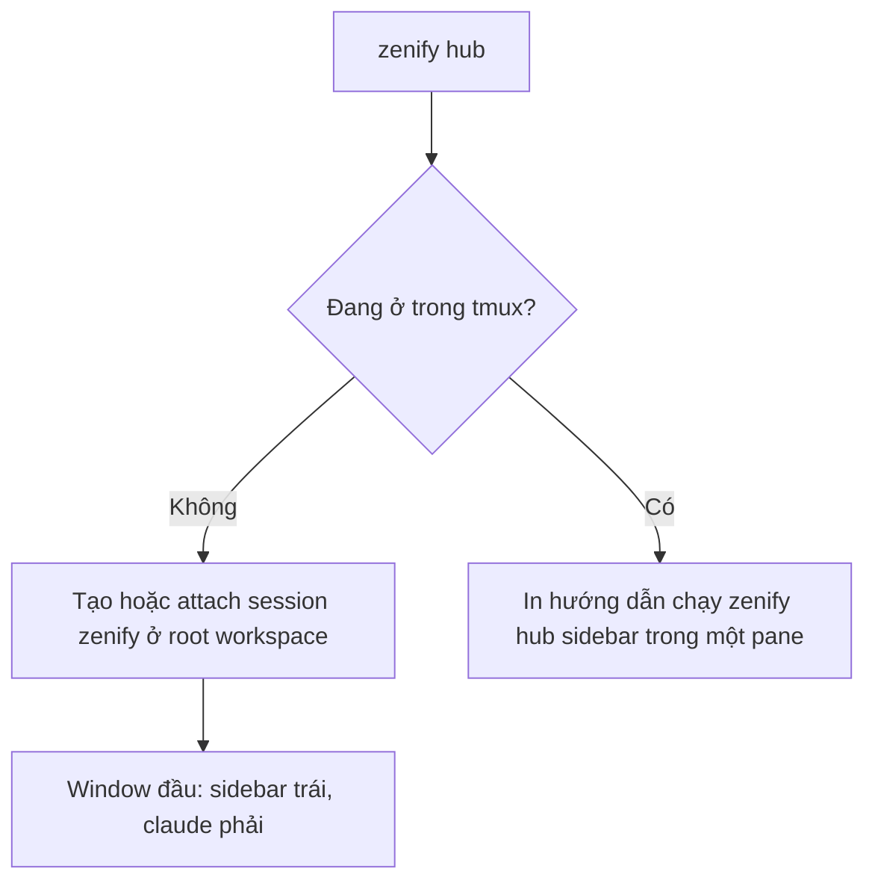

# zenify hub: sidebar agent

`zenify hub` mở một tmux session `zenify` ở root workspace, gồm một sidebar bên trái và agent `claude` bên phải. Sidebar gom theo task (slug của worktree): mỗi task hiện agent đang làm, PR, CI, review và mergeState của từng repo, để bạn không phải nhớ tay task nào đang chạy hay PR nào đã CLEAN.

## Khi nào dùng

Dùng khi bạn chạy nhiều agent song song trên nhiều task (`zenify wt new`) và muốn một chỗ nhìn trạng thái, nhảy tới agent đang chờ bạn, hoặc biết khi CI fail. Agent sống trong tmux nên đóng terminal không làm mất agent.

## Yêu cầu

Cần tmux từ 3.1 trở lên (hub dùng `split-window -l <n>%`). `zenify doctor` có check `tmux`; thiếu tmux hoặc version thấp hơn 3.1 thì check này fail kèm lệnh cài.

| Cách | Lệnh |
|---|---|
| Tự cài | `zenify doctor --fix`: macOS dùng `brew install tmux`; Linux dùng `sudo apt-get install -y tmux`, không có apt-get thì `sudo dnf install -y tmux`, không có cả hai thì `brew install tmux` nếu có brew |
| Cài tay | Cài tmux ≥ 3.1 bằng package manager của máy. Windows: dùng WSL |

`zenify up` chạy cùng check và in gợi ý khi thiếu tmux, nhưng không tự cài. Khi `--fix` cài xong, doctor chạy lại check; không có package manager nào thì nó in hướng dẫn cài tay.

## Các bước

*Cách `zenify hub` mở sidebar*

- Không tìm thấy workspace root: hub báo `not inside a zenify workspace` và thoát với mã khác 0.
- Thiếu tmux hoặc tmux thấp hơn 3.1: hub báo lỗi kèm hướng dẫn cài tmux và thoát với mã khác 0. Check này chạy trước check "đang ở trong tmux" bên dưới.
- Ngoài tmux: nếu session `zenify` chưa có, hub tạo nó với cwd là root workspace, window đầu gồm sidebar trái và `claude` phải, rồi attach. Đã có session thì chỉ attach.
- Đang ở trong tmux (bất kỳ session nào): hub không lồng session, chỉ in hướng dẫn chạy `zenify hub sidebar` trong một pane rồi thoát với mã 0.

Phím `n` trong sidebar mở thêm một window agent mới ở root, mỗi window cũng có sidebar bên trái; con trỏ ở lại pane `claude`. Hub bật `allow-passthrough` cho window đó để copy OSC 52 chạy được; tmux cũ hơn 3.3 không có option này nên footer báo lỗi nhưng window vẫn dùng được. Chỉ một sidebar giữ lock và chạy poller; các sidebar khác đọc cùng `state.json`. Không có daemon riêng, đóng hết session thì poller mất theo.

## Sidebar

Dòng đầu là `zenify hub` kèm giờ của vòng quét local gần nhất (HH:MM:SS); mỗi mục có số đếm (`TASKS 4`), các mục cách nhau bằng đường kẻ, dòng cuối gợi ý phím. Danh sách cuộn theo con trỏ, dòng đang chọn có nền highlight. Sidebar có ba mục:

| Mục | Nội dung |
|---|---|
| `TASKS` | Từng task với icon trạng thái roll-up và agent gắn kèm; dưới mỗi task là từng repo, kèm PR `#n`, icon CI, review và mergeState. Task có agent hoặc PR lên trước (theo roll-up), còn lại theo slug. Task một repo chưa có PR gọn một dòng `<icon> <slug> · <repo>`. Task mà mọi repo đã merged, không có agent và không có PR open, gom vào dòng `▸ merged (n)` cuối mục, `Enter` để mở/đóng |
| `AGENTS` | Agent chưa có slug, hoặc có slug không khớp task nào hiện có (ví dụ worktree đã sweep) |
| `MY PRS` | PR open của bạn không khớp worktree nào, chỉ lấy PR thuộc owner của remote `origin` các repo workspace (PR repo cá nhân bị bỏ; khi chưa đọc được owner nào thì không hiện PR nào) |

Dòng PR có dạng `<repo> #<n> <CI> <mergeState> <review> <n> threads`; phần review hiện `approved`, `changes` (CHANGES_REQUESTED) hoặc `review` (REVIEW_REQUIRED), kèm số thread chưa resolve.

### Icon

| Icon | Nghĩa |
|---|---|
| `●` | Agent đang làm việc (working) |
| `◆` | Agent bị chặn, chờ bạn duyệt quyền hoặc trả lời (blocked) |
| `✓` | Agent xong, bạn chưa xem (done) |
| `○` | Agent rảnh (idle) |
| `✓` / `✗` / `◐` (cạnh PR) | CI thành công / thất bại / đang chạy |
| `!` | PR có alert chưa được xác nhận |

Icon của task là roll-up của các agent trong task, theo ưu tiên blocked, working, done, idle. Nhảy tới một agent `done` sẽ chuyển nó về `idle`.

### Phím

| Phím | Tác dụng |
|---|---|
| `j` / `k` / `↓` / `↑` | Di chuyển |
| `Enter` | Nhảy tới pane agent của task hoặc agent, kể cả khi pane nằm ở session tmux khác; task có nhiều agent thì chọn agent có trạng thái ưu tiên cao nhất, hoà thì agent mới cập nhật nhất. Task chưa có agent thì hỏi `y/n` rồi mở window agent mới. Trên dòng ở mục `MY PRS` thì mở PR như `o` |
| `n` | Mở window agent mới ở root |
| `o` | Mở PR bằng trình duyệt (`gh pr view --web`) |
| `y` | Copy URL PR |
| `m` | Copy lệnh `gh pr merge <n> --repo <owner/repo> --merge`; hub không tự merge |
| `r` | Yêu cầu poller refresh GitHub ngay |
| `f` | Gửi `/znf:fix <url job lỗi>` vào agent của task (xem [CI watch](#ci-watch)) |
| `q` | Thoát sidebar |

Copy dùng công cụ clipboard có trên máy theo thứ tự `wl-copy` (khi có `WAYLAND_DISPLAY`), `xclip`, `xsel` (khi có `DISPLAY`), `pbcopy` (macOS); không có công cụ nào thì dùng OSC 52 (chạy được qua tmux và SSH). Lỗi của công cụ hiện ở footer. Câu hỏi xác nhận trong sidebar chỉ nhận `y` để đồng ý; phím khác là hủy.

## CI watch

Poller so PR giữa hai vòng và tạo alert, báo bằng một thông báo tmux ngắn (`display-message`) cùng dấu `!` trên dòng PR:

| Alert | Khi nào |
|---|---|
| `ci-failed` | CI chuyển sang thất bại |
| `ready` | PR đạt mergeState `CLEAN` và không còn thread chưa resolve |
| `new-review` | Số thread chưa resolve tăng |

Alert được xoá khi bạn bấm `o` hoặc `f` trên PR đó, `Enter` trên PR ở mục `MY PRS`, hoặc `Enter` khi nhảy tới agent (xác nhận mở agent mới không xoá alert). Nhịp poll GitHub là 20 giây khi bạn có ít nhất một PR đang `PENDING`, ngược lại 60 giây; phím `r` bỏ qua nhịp chờ.

Phím `f` chỉ hoạt động trên PR có CI thất bại. Job lỗi là check run kết thúc `FAILURE`, `TIMED_OUT`, `STARTUP_FAILURE`, `CANCELLED` hoặc `ACTION_REQUIRED`, hoặc commit status `FAILURE`/`ERROR` có link; PR không có link job lỗi nào thì sidebar báo `no failed job URL for this PR` và không gõ gì. Nó gõ `/znf:fix <url job lỗi đầu tiên>` vào pane agent của task, chỉ khi bạn bấm, không bao giờ tự động. Nếu agent đang `blocked` (có thể đang ở hộp thoại quyền), hub hỏi `y/n` trước khi gõ. Task chưa có agent thì sidebar báo `no agent on this task` và không gõ gì. Alert chỉ được xác nhận sau khi thao tác của `f` chạy xong.

## Hook hub-report

Trạng thái agent đến từ Claude Code hooks. `zenify up` cài hook `hub-report` (qua `zenify hooks-run hub-report`) cho sáu event: `SessionStart`, `UserPromptSubmit`, `PostToolUse`, `Notification`, `Stop`, `SessionEnd`; `zenify down` gỡ nó cùng các hook khác của kit. Hook chỉ dành cho Claude Code, không cài cho Codex.

| Event | Trạng thái |
|---|---|
| `SessionStart` | idle (`source` là `compact` hoặc `resume` thì giữ nguyên trạng thái) |
| `UserPromptSubmit`, `PostToolUse` | working |
| `Notification` loại `permission_prompt`, `agent_needs_input` hoặc `elicitation_dialog` | blocked (loại khác giữ nguyên trạng thái) |
| `Stop` | done |
| `SessionEnd` | xoá bản ghi agent |

Task của agent được suy ra từ đường dẫn `/.worktrees/<slug>` xuất hiện trong tool input, xét các key `file_path`, `notebook_path`, `path`, `command`, `cwd` trước rồi mới tới các key khác; không khớp thì giữ slug cũ; agent chưa có slug nằm ở mục `AGENTS`. Hook fail-open: ngoài tmux (không có `TMUX_PANE`) nó không ghi gì, và mọi lỗi chỉ ghi vào `~/.zenify/hub/hub.log` rồi thoát mã 0, nên không bao giờ chặn agent. Bạn cũng có thể gọi tay `zenify hub report` với JSON hook trên stdin để debug.

## Dữ liệu

Mọi dữ liệu hub nằm ở `~/.zenify/hub/`: `state.json` (cache chung cho các sidebar), `agents/<session>.json` (trạng thái từng agent; có `title` là 60 ký tự đầu của prompt đầu tiên, chỉ lưu trên máy bạn), `acks/` (alert đã xác nhận) và `hub.log` (lỗi). Khi poller gặp lỗi `gh` hoặc `git`, nó giữ dữ liệu cũ và sidebar hiện lỗi gần nhất.

## Lưu ý

- Kit không còn dùng herdr. `zenify wt sweep` không đóng workspace hay window nào nữa; window shell bạn tự mở trong worktree vẫn giữ nguyên, bạn tự đóng.
- Task xuất hiện sau khoảng một giây kể từ `zenify wt new`: thêm hoặc xoá thư mục worktree kích hoạt vòng quét local ngay; ngoài ra vòng quét local chạy mỗi 10 giây (cập nhật trạng thái merged), độc lập với vòng GitHub.

### Giới hạn của v1

- Chỉ Claude Code được theo dõi; hook `hub-report` không cài cho agent khác (codex...), nên các agent đó không báo trạng thái và không xuất hiện trên sidebar.
- Reboot làm mất process agent; task và PR vẫn hiện lại từ git và GitHub, nhưng agent không tự resume.
- Chỉ trên máy local: không có remote machine, webhook hay thông báo GitHub, nên PR có thể trễ tới 60 giây (dùng phím `r`).
- Không có thông báo desktop; chỉ thấy khi đang ở terminal.
- Agent có tool input không chứa đường dẫn worktree không được gắn vào task nào, và nằm ở mục `AGENTS`.
- Hub không bao giờ tự merge PR và không tự gửi `/znf:fix`.

## Xem thêm

[`zenify hub`](/reference/cli/zenify_hub), [`zenify doctor`](/reference/cli/zenify_doctor), [Hook](/reference/hooks), [Review và gate](/guides/review-and-gates)

<!-- Nguồn (cho người bảo trì, không hiển thị):
- `internal/hub/sidebar.go`, `actions.go`, `github.go` (phím, icon, alert, interval)
- `internal/apply/globalhooks.go` (hub-report events)
- `internal/cli/doctor_tmux.go` (check tmux, --fix)
- spec 2026-10-27-zenify-hub-design.md
-->
