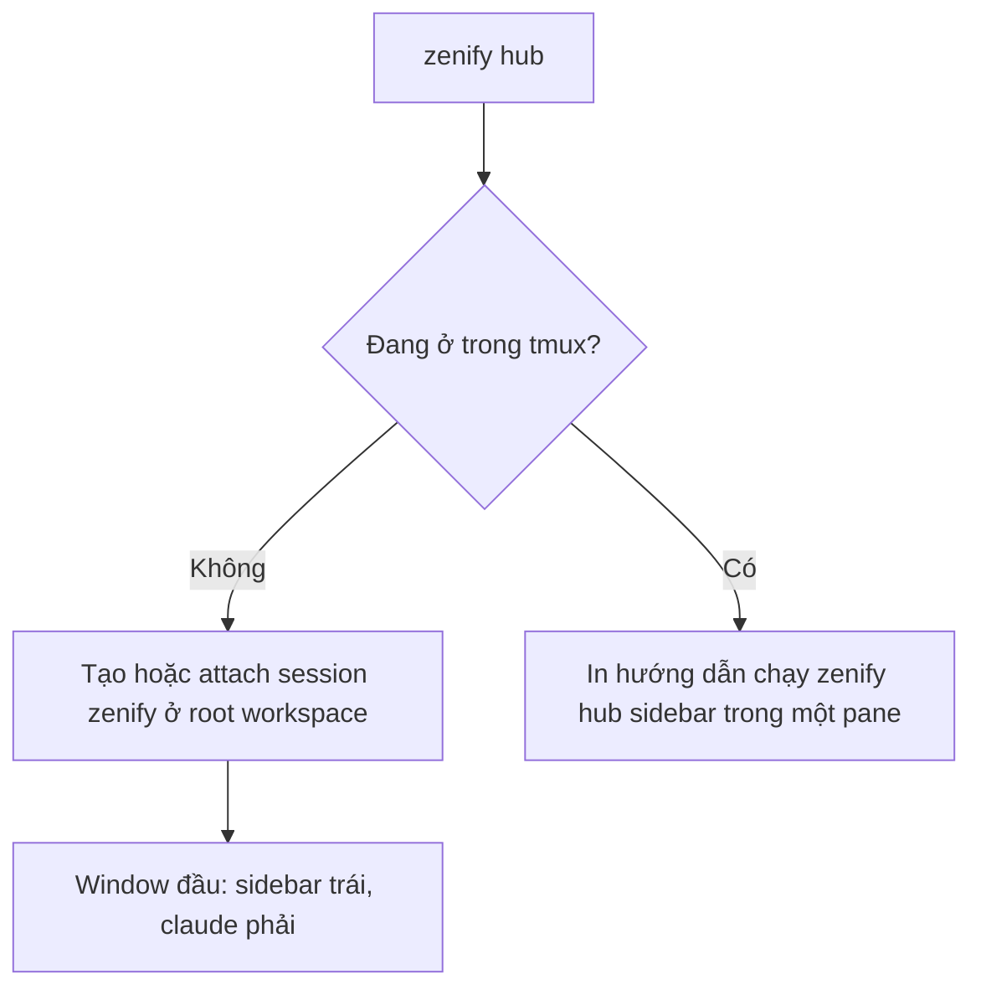

# zenify hub: sidebar agent

`zenify hub` mở một tmux session `zenify` ở root workspace, gồm một sidebar bên trái và agent `claude` bên phải. Sidebar gom theo task (slug của worktree): mỗi task hiện agent đang làm, PR, CI, review và mergeState của từng repo, để bạn không phải nhớ tay task nào đang chạy hay PR nào đã CLEAN.

## Khi nào dùng

Dùng khi bạn chạy nhiều agent song song trên nhiều task (`zenify wt new`) và muốn một chỗ nhìn trạng thái, nhảy tới agent đang chờ bạn, hoặc biết khi CI fail. Agent sống trong tmux nên đóng terminal không làm mất agent.

## Yêu cầu

Cần tmux từ 3.1 trở lên (hub dùng `split-window -l <n>%`). `zenify doctor` có check `tmux`; thiếu tmux hoặc version thấp hơn 3.1 thì check này fail kèm lệnh cài.

| Cách | Lệnh |
|---|---|
| Tự cài | `zenify doctor --fix`: macOS dùng `brew install tmux`; Linux dùng `sudo apt-get install -y tmux`, không có apt-get thì `sudo dnf install -y tmux`, không có cả hai thì `brew install tmux` nếu có brew |
| Cài tay | Cài tmux ≥ 3.1 bằng package manager của máy. Windows: dùng WSL |

`zenify up` chạy cùng check và in gợi ý khi thiếu tmux, nhưng không tự cài. Khi `--fix` cài xong, doctor chạy lại check; không có package manager nào thì nó in hướng dẫn cài tay.

## Các bước



*Cách `zenify hub` mở sidebar*

- Không tìm thấy workspace root: hub báo `not inside a zenify workspace` và thoát với mã khác 0.
- Thiếu tmux hoặc tmux thấp hơn 3.1: hub báo lỗi kèm hướng dẫn cài tmux và thoát với mã khác 0. Check này chạy trước check "đang ở trong tmux" bên dưới.
- Ngoài tmux: nếu session `zenify` chưa có, hub tạo nó với cwd là root workspace, window đầu gồm sidebar trái và `claude` phải, rồi attach (xem [Resume agent khi mở hub](#resume-agent-khi-mo-hub)). Đã có session thì chỉ attach. Nếu bước dựng sau `new-session` lỗi, hub xoá session vừa tạo; nếu chính `new-session` lỗi (ví dụ một lần chạy `zenify hub` khác vừa tạo session) thì hub báo lỗi và không xoá gì.
- Đang ở trong tmux (bất kỳ session nào): hub không lồng session, chỉ in hướng dẫn chạy `zenify hub sidebar` trong một pane rồi thoát với mã 0.

Phím `n` trong sidebar mở thêm một window agent mới ở root trong session `zenify` (chưa có session đó thì mở trong session hiện tại của sidebar), mỗi window cũng có sidebar bên trái; con trỏ ở lại pane `claude`. Hub bật `allow-passthrough` cho window đó để copy OSC 52 chạy được; tmux cũ hơn 3.3 không có option này nên footer báo lỗi nhưng window vẫn dùng được. Chỉ một sidebar giữ lock và chạy poller; các sidebar khác đọc cùng `state.json`. Không có daemon riêng, đóng hết session thì poller mất theo.

## Sidebar

Dòng đầu là `zenify hub` kèm giờ của vòng quét local gần nhất (HH:MM:SS); mỗi mục có số đếm (`TASKS 4`), các mục cách nhau bằng đường kẻ, dòng cuối gợi ý phím. Danh sách cuộn theo con trỏ, dòng đang chọn có nền highlight. Khi bạn chưa di chuyển con trỏ, nó luôn ở dòng chọn được đầu tiên; sau đó nó bám theo đúng dòng (repo + worktree, hoặc PR) dù danh sách đổi thứ tự sau mỗi lần nạp lại. Lỗi ở footer chỉ hiện dòng đầu, cắt theo bề rộng pane, kèm `(+N more, see ~/.zenify/hub/hub.log)` khi còn dòng khác; mọi lỗi hiện ở footer (lỗi phím bấm, lỗi lock/đọc state, lỗi vòng quét) đều được ghi vào `hub.log`, lỗi lặp lại ở mỗi tick chỉ ghi một lần. Sidebar có ba mục:

| Mục | Nội dung |
|---|---|
| `TASKS` | Nhóm theo repo rồi worktree (xem [Mục TASKS](#muc-tasks)) |
| `AGENTS` | Mọi agent có bản ghi, đang mở hay đã đóng (xem [Mục AGENTS](#muc-agents)) |
| `MY PRS` | PR open của bạn không khớp worktree nào, chỉ lấy PR thuộc owner của remote `origin` các repo workspace (PR repo cá nhân bị bỏ; khi chưa đọc được owner nào thì không hiện PR nào, áp dụng cho mọi PR gồm cả badge ở TASKS) |

### Mục TASKS

```
 TASKS 5
 ▾ contact-center-be 3
   ◆ zns-campaign-trace  agent#2
       #799 ✗ BLOCKED changes
   ● redis-scan-storm  agent#1
       #812 ✓ CLEAN
   ○ be-2376-tests
 ▾ contact-center-web 2
   ◆ zns-campaign-trace  agent#2
       #455 ◐ review
   ○ web-sync-release92
 ▸ zenify-packages 6
 ▸ merged (21)
```

- Cấp 1 là repo (tên thư mục repo) kèm số worktree; cấp 2 là worktree `<icon> <slug>  <agent>`, dòng PR của branch đó nằm ngay dưới. Task nhiều repo xuất hiện dưới mỗi repo của nó, mỗi chỗ với PR riêng của repo đó, agent hiện ở mọi chỗ.
- Repo có ít nhất một worktree có agent hoặc PR open thì mở sẵn và xếp trước (theo roll-up cao nhất, rồi tên); repo còn lại thu gọn và xếp sau theo tên. Trong một repo, worktree có agent hoặc PR lên trước (theo roll-up, rồi slug), còn lại theo slug.
- `Enter` hoặc `Space` trên dòng repo để mở/đóng; lựa chọn của bạn được giữ khi state reload.
- Worktree mà repo đã merged nhưng task vẫn có agent hoặc PR open ở repo khác thì ở lại nhóm repo, dòng của nó có hậu tố mờ ` merged`.
- Worktree mà repo đã merged và task không có agent, không có PR open, gom vào dòng `▸ merged (n)` cuối mục (n là số worktree); mở ra thì liệt kê `repo/slug`.
- Số ở header `TASKS` là số worktree không nằm trong nhóm merged.
- Các phím `Enter`, `o`, `y`, `m`, `f` trên dòng worktree hoặc dòng PR của nó tác động lên PR của đúng repo đó.

Dòng worktree có agent hiện `▶` (agent đang mở) hoặc `⏸` (đã đóng) ngay trước tên agent, ví dụ `● redis-scan-storm  ▶ agent#1`.

Dòng PR có dạng `#<n> <CI> <mergeState> <review> <n> threads` (ở mục `MY PRS` có thêm tên repo phía trước); phần review hiện `approved`, `changes` (CHANGES_REQUESTED) hoặc `review` (REVIEW_REQUIRED), kèm số thread chưa resolve.

### Mục AGENTS

```
 AGENTS 2/3
 ▶ ◆ fix login · zns-campaign-trace w2
 ▶ ● redis-scan-storm · redis-scan-storm w1
 ⏸ ○ daily notes
```

- Header `AGENTS <mở>/<tổng>`. Mỗi dòng: `▶`/`⏸`, icon trạng thái, tiêu đề agent (không có tiêu đề thì slug), `· <slug>` khi agent gắn với task, và `w<số window>` khi agent đang mở.
- Agent **đang mở** khi pane của nó còn sống trên đúng tmux server mà hook đã ghi (pid server lấy từ trường thứ 2 của env `TMUX`); ngược lại là **đã đóng**, ví dụ sau khi tmux server bị tắt hoặc máy reboot. Poller tính lại mỗi vòng quét local; không có tmux server nào chạy thì mọi agent là đã đóng.
- Agent đang mở xếp trước (theo trạng thái blocked, working, done, idle, rồi mới cập nhật nhất), sau đó agent đã đóng (mới cập nhật nhất trước).
- `Enter` trên agent đang mở nhảy tới pane của nó; trên agent đã đóng mở một window mới `sidebar | claude --resume <session id>` trong session `zenify` (chưa có session đó thì trong session hiện tại). `claude --resume` giữ nguyên session id nên agent tiếp tục ghi vào bản ghi cũ.
- `x` trên agent đã đóng hỏi `Forget agent <tên>? y/n` rồi xoá bản ghi của agent; trên agent đang mở thì sidebar báo `agent is running` và không xoá gì.

### Icon

| Icon | Nghĩa |
|---|---|
| `●` | Agent đang làm việc (working) |
| `◆` | Agent bị chặn, chờ bạn duyệt quyền hoặc trả lời (blocked) |
| `✓` | Agent xong, bạn chưa xem (done) |
| `○` | Agent rảnh (idle) |
| `▶` / `⏸` (cạnh agent) | Agent đang mở / đã đóng |
| `✓` / `✗` / `◐` (cạnh PR) | CI thành công / thất bại / đang chạy |
| `!` | PR có alert chưa được xác nhận |

Icon của task là roll-up của các agent trong task, theo ưu tiên blocked, working, done, idle. Nhảy tới một agent `done` sẽ chuyển nó về `idle`.

### Phím

| Phím | Tác dụng |
|---|---|
| `j` / `k` / `↓` / `↑` | Di chuyển |
| `Enter` | Nhảy tới pane agent của task hoặc agent, kể cả khi pane nằm ở session tmux khác; task có nhiều agent thì chọn agent có trạng thái ưu tiên cao nhất, hoà thì agent mới cập nhật nhất. Agent đó đã đóng thì mở window mới chạy `claude --resume <session id>`. Task chưa có agent thì hỏi `y/n` rồi mở window agent mới. Trên dòng ở mục `MY PRS` thì mở PR như `o`. Trên dòng repo hoặc dòng `merged (n)` thì mở/đóng nhóm |
| `Space` | Mở/đóng nhóm repo hoặc nhóm `merged (n)`; trên dòng khác không làm gì |
| `n` | Mở window agent mới ở root |
| `o` | Mở PR bằng trình duyệt (`gh pr view --web`) |
| `y` | Copy URL PR |
| `m` | Copy lệnh `gh pr merge <n> --repo <owner/repo> --merge`; hub không tự merge |
| `r` | Yêu cầu poller refresh GitHub ngay |
| `f` | Gửi `/znf:fix <url job lỗi>` vào agent của task (xem [CI watch](#ci-watch)) |
| `x` | Trên dòng agent đã đóng ở mục `AGENTS`: hỏi `y/n` rồi quên agent (xoá bản ghi) |
| `q` | Thoát sidebar |

Copy dùng công cụ clipboard có trên máy theo thứ tự `wl-copy` (khi có `WAYLAND_DISPLAY`), `xclip`, `xsel` (khi có `DISPLAY`), `pbcopy` (macOS); không có công cụ nào thì dùng OSC 52 (chạy được qua tmux và SSH). Lỗi của công cụ hiện ở footer. Câu hỏi xác nhận trong sidebar chỉ nhận `y` để đồng ý; phím khác là hủy.

## Resume agent khi mở hub

Khi `zenify hub` tạo session `zenify` mới, nó resume các agent đã đóng thay vì mở một `claude` trống:

- Ứng viên là agent đã đóng có cập nhật trong 7 ngày gần nhất, tối đa 8 agent, mới nhất trước. Agent còn đang mở ở session tmux khác không bị resume lần nữa.
- Window đầu chạy `claude --resume <session id>` của ứng viên mới nhất; mỗi ứng viên còn lại có một window riêng `sidebar | claude --resume <session id>`. Tên window là slug của agent (không có slug thì `agent`, dấu `.` và `:` đổi thành `-`); cwd là root workspace.
- Session id không đúng dạng UUID (chỉ chữ số hex và `-`) bị bỏ qua và ghi lỗi vào `hub.log`.
- Không có ứng viên nào thì hub mở `claude` mới như trước. Một bước dựng window lỗi thì hub xoá session vừa tạo.

## CI watch

Poller so PR giữa hai vòng và tạo alert, báo bằng một thông báo tmux ngắn (`display-message`) cùng dấu `!` trên dòng PR:

| Alert | Khi nào |
|---|---|
| `ci-failed` | CI chuyển sang thất bại |
| `ready` | PR đạt mergeState `CLEAN` và không còn thread chưa resolve |
| `new-review` | Số thread chưa resolve tăng |

Alert được xoá khi bạn bấm `o` hoặc `f` trên PR đó, `Enter` trên PR ở mục `MY PRS`, hoặc `Enter` khi nhảy tới agent (xác nhận mở agent mới không xoá alert). Nhịp poll GitHub là 20 giây khi bạn có ít nhất một PR đang `PENDING`, ngược lại 60 giây; phím `r` bỏ qua nhịp chờ.

Phím `f` chỉ hoạt động trên PR có CI thất bại. Job lỗi là check run kết thúc `FAILURE`, `TIMED_OUT`, `STARTUP_FAILURE`, `CANCELLED` hoặc `ACTION_REQUIRED`, hoặc commit status `FAILURE`/`ERROR` có link; PR không có link job lỗi nào thì sidebar báo `no failed job URL for this PR` và không gõ gì. Nó gõ `/znf:fix <url job lỗi đầu tiên>` vào pane agent của task, chỉ khi bạn bấm, không bao giờ tự động. Hub đọc lại file trạng thái của agent ngay lúc bấm (không dùng cache của vòng quét) và gõ vào pane trong file đó; file không còn (session agent đã kết thúc) thì sidebar báo `agent session ended` và không gõ gì; nếu agent đang `blocked` (có thể đang ở hộp thoại quyền), hub hỏi `y/n` trước khi gõ. Task chưa có agent thì sidebar báo `no agent on this task` và không gõ gì. Alert chỉ được xác nhận sau khi thao tác của `f` chạy xong.

## Hook hub-report

Trạng thái agent đến từ Claude Code hooks. `zenify up` cài hook `hub-report` (qua `zenify hooks-run hub-report`) cho sáu event: `SessionStart`, `UserPromptSubmit`, `PostToolUse`, `Notification`, `Stop`, `SessionEnd`; `zenify down` gỡ nó cùng các hook khác của kit. Hook chỉ dành cho Claude Code, không cài cho Codex.

| Event | Trạng thái |
|---|---|
| `SessionStart` | idle (chỉ `source=compact` giữ nguyên trạng thái; `resume` về idle) |
| `UserPromptSubmit`, `PostToolUse` | working |
| `Notification` loại `permission_prompt`, `agent_needs_input` hoặc `elicitation_dialog` | blocked (loại khác giữ nguyên trạng thái) |
| `Stop` | done |
| `SessionEnd` | xoá bản ghi agent |

Hook ghi cùng bản ghi pane (`TMUX_PANE`) và pid tmux server (trường thứ 2 của `TMUX`). Khi một hook báo từ pane P trên server S, mọi bản ghi agent khác cùng (S, P) bị xoá, vì một pane chỉ chạy một Claude (pane id được tái dùng sau khi server khởi động lại). Task của agent được suy ra từ đường dẫn `/.worktrees/<slug>` xuất hiện trong tool input, xét các key `file_path`, `notebook_path`, `path`, `command`, `cwd` trước rồi mới tới các key khác; không khớp thì giữ slug cũ; agent chưa có slug chỉ hiện ở mục `AGENTS`. Hook fail-open: ngoài tmux (không có `TMUX_PANE` hoặc `TMUX`) nó không ghi gì, và mọi lỗi chỉ ghi vào `~/.zenify/hub/hub.log` rồi thoát mã 0, nên không bao giờ chặn agent. Bạn cũng có thể gọi tay `zenify hub report` với JSON hook trên stdin để debug.

## Dữ liệu

Mọi dữ liệu hub nằm ở `~/.zenify/hub/`: `state.json` (cache chung cho các sidebar), `agents/<session>.json` (trạng thái từng agent; có `title` là 60 ký tự đầu của prompt đầu tiên, chỉ lưu trên máy bạn), `acks/` (alert đã xác nhận) và `hub.log` (lỗi). Khi poller gặp lỗi `gh` hoặc `git`, nó giữ dữ liệu cũ và sidebar hiện lỗi gần nhất của vòng local và vòng GitHub cho tới khi vòng cùng loại kế tiếp chạy thành công.

## Lưu ý

- Kit không còn dùng herdr. `zenify wt sweep` không đóng workspace hay window nào nữa; window shell bạn tự mở trong worktree vẫn giữ nguyên, bạn tự đóng.
- Task xuất hiện sau khoảng một giây kể từ `zenify wt new`: thêm hoặc xoá thư mục worktree kích hoạt vòng quét local ngay; ngoài ra vòng quét local chạy mỗi 10 giây (cập nhật trạng thái merged), độc lập với vòng GitHub.

### Giới hạn của v1

- Chỉ Claude Code được theo dõi; hook `hub-report` không cài cho agent khác (codex...), nên các agent đó không báo trạng thái và không xuất hiện trên sidebar.
- Reboot hoặc tmux server bị tắt làm mất process agent; lần `zenify hub` kế tiếp resume tối đa 8 agent đã đóng trong 7 ngày (xem [Resume agent khi mở hub](#resume-agent-khi-mo-hub)), các agent khác resume tay bằng `Enter` ở mục `AGENTS`.
- Chỉ trên máy local: không có remote machine, webhook hay thông báo GitHub, nên PR có thể trễ tới 60 giây (dùng phím `r`).
- Không có thông báo desktop; chỉ thấy khi đang ở terminal.
- Agent có tool input không chứa đường dẫn worktree không được gắn vào task nào; nó chỉ hiện ở mục `AGENTS`.
- Hub không bao giờ tự merge PR và không tự gửi `/znf:fix`.

## Xem thêm

[`zenify hub`](/reference/cli/zenify_hub), [`zenify doctor`](/reference/cli/zenify_doctor), [Hook](/reference/hooks), [Review và gate](/guides/review-and-gates)

<!-- Nguồn (cho người bảo trì, không hiển thị):
- `internal/hub/sidebar.go`, `actions.go`, `github.go` (phím, icon, alert, interval)
- `internal/hub/collect.go` (liveness agent), `internal/cli/hub.go` (resume khi mở hub)
- `internal/apply/globalhooks.go` (hub-report events)
- `internal/cli/doctor_tmux.go` (check tmux, --fix)
- spec 2026-10-27-zenify-hub-design.md
-->
