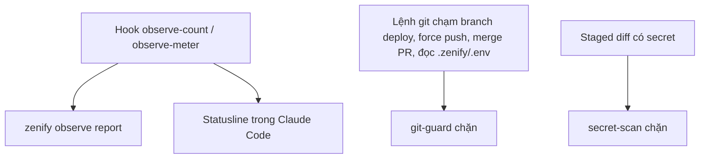

# Quan sát và an toàn

Kit theo dõi mức fan-out subagent và lượng tool output của mỗi phiên Claude Code, và chặn commit lộ secret hoặc chạm nhầm branch deploy. Ba mảng này chạy nền, bạn chỉ đọc kết quả hoặc xử lý khi bị chặn.

## Khi nào dùng

Xem `zenify observe report` khi bạn muốn biết một phiên đã fan-out bao nhiêu subagent và tiêu tốn bao nhiêu tool output. Cài statusline khi bạn muốn thấy các số đó ngay trong Claude Code thay vì chạy lệnh riêng.

Chạy `zenify secret-scan` trước khi push một branch có file cấu hình hoặc script mới. CI của mọi repo public đã chạy lệnh này cho bạn.

`zenify up` và hook `SessionStart` tự gắn git-guard khi thiếu. Chạy `zenify guard install` (hoặc `zenify doctor --fix`) khi `zenify doctor` báo mục `git-guard` hỏng, hoặc sau khi bạn sửa tay `~/.claude/settings.json`.

## Các bước



*Quan sát số liệu phiên, và hai chốt chặn an toàn*

## Lệnh

### `zenify observe report`

| Cờ | Ý nghĩa |
|---|---|
| `--json` | In JSON thay cho bảng. |

```bash
zenify observe report
```

Kết quả là một bảng theo phiên, phiên hoạt động gần nhất hiện trước. Dữ liệu đến từ hai hook `observe-count` và `observe-meter` mà `zenify up` đã cài.

### `zenify observe statusline`

Claude Code gọi lệnh này qua key `statusLine` trong `~/.claude/settings.json`. Dòng statusline gồm các đoạn, ẩn khi trống: model, phần trăm ngữ cảnh, số dispatch subagent, lượng tool output và chi phí.

```bash
zenify observe statusline install
```

| Cờ | Ý nghĩa |
|---|---|
| `--segment` | Chỉ in hai đoạn của kit, số dispatch và tool output, để ghép vào statusline sẵn có. |
| `--force` (của `install`) | Đè statusline hiện có. |

Claude Code chỉ cho phép một statusline. Lệnh `install` chỉ ghi khi key `statusLine` còn trống; đã có statusline khác thì lệnh từ chối và gợi ý ghép đoạn bằng `--segment`, hoặc đè bằng `--force`.

### `zenify secret-scan`

```bash
zenify secret-scan .
```

Mỗi finding in ra một dòng gồm file, số dòng, tên rule và giá trị đã che, không in secret nguyên văn. Có finding thì lệnh kết thúc lỗi để CI đỏ. Không truyền đường dẫn, lệnh quét thư mục hiện tại.

### `zenify guard install`

```bash
zenify guard install
```

Lệnh đăng ký hook `PreToolUse` với matcher `Bash` trỏ tới `zenify git-guard`, và gỡ mục cũ nếu còn. Chạy lại khi đã có cấu hình, lệnh chỉ báo đã sẵn và không ghi gì. Danh sách branch deploy đọc từ `.claude/deploy-branches` của từng repo.

## Nguồn bằng chứng cho agent {#nguon-bang-chung-cho-agent}

Khi điều tra một triệu chứng trên staging hay production, các skill `/znf:fix`, `/znf:hotfix`, `/znf:scout`, `/znf:gate`, `/znf:service-integration` và `/znf:explain-plan` cùng đọc một tài liệu tham chiếu chung, `_shared/evidence-sources.md` (nằm trong `internal/plugin/assets/znf/skills/_shared/`). Tài liệu này nêu thứ tự tra cứu theo triệu chứng (log, trace, metric, `zenify db-read`/`redis-read`, PostHog), cách chuyển từ nguồn này sang nguồn khác, các ngõ cụt đã đo, giới hạn kích thước output và việc phải làm khi một nguồn không có. Phần về role dev trên production lấy danh sách lệnh từ bảng quyền của chính kit, nên khớp với broker cùng phiên bản (xem [giới hạn dev ở trang broker](/guides/broker-client#lead-dev)); broker cũ hơn hoặc mới hơn kit có thể áp danh sách khác, khi đó nâng cấp cả hai lên cùng phiên bản. Agent không tự gõ tên công cụ hay mã định danh từ trí nhớ mà đọc từ tài liệu này.

## Kết quả

| Artifact | Nội dung |
|---|---|
| Bảng hoặc JSON của `observe report` | Số dispatch subagent và tool output theo phiên |
| Đoạn statusline | Model, % ngữ cảnh, dispatch, tool output, chi phí |
| Output `secret-scan` | Danh sách finding `file:line:rule`, giá trị che |
| Hook git-guard | Chặn commit, push, merge vào branch trong `.claude/deploy-branches`, kể cả khi gọi qua alias `git -c alias.<tên>=push <tên>` |
| Hook git-guard (lệnh lồng) | Theo vào `bash -c`, `sh -c`, `zsh -c` và `eval` (tối đa 3 tầng), bỏ các wrapper ở đầu lệnh, rồi áp các luật dưới đây. Chuỗi lồng có biến (`bash -c "… $X"`) và shell đọc script từ stdin (heredoc, pipe vào `sh`, `-s`) được coi là không phân tích được |
| Hook git-guard (force push) | Chặn force push (`--force`, `-f`, cờ gộp như `-uf`, `--force-with-lease`, `--force-if-includes`, refspec `+<branch>`) trên mọi branch |
| Hook git-guard (merge PR) | Chặn `gh pr merge` và `gh api … PUT …/merge` |
| Hook git-guard (stack) | Chặn `gh stack merge`, `gh stack unstack` và `gh stack delete` (trừ khi có `--local`), `gh stack link`, `gh stack alias` (lệnh tắt nó cài, mặc định `gs`, guard không nhận ra), `gh api` tới đường dẫn `merge-async` hoặc `/stacks/<n>/unstack`, và `gh stack init`, `gh stack add` với tên deploy branch. Merge, gỡ và ghép stack là việc của người |
| Hook git-guard (worktree) | Chặn `wt rm --force`, `wt rm -f`, `zenify wt rm --force` hoặc `-f`, và `git worktree remove --force` hoặc `-f` |
| Hook git-guard (secret) | Chặn đọc `<workspace>/.zenify/.env` qua Bash, kể cả qua redirect (`<`, `3<`, `<<<`); chặn lệnh đọc cả thư mục (`grep`, `rg`, `find`, `tar`, `cp`, `cat`, …) nhắm vào chính thư mục `.zenify`, và mọi lệnh nhắm vào một glob trong đó (`.zenify/*`) hay một file `.env` trong đó. Thư mục `.zenify/data-runs/` (bản ghi dry-run và log ghi của `zenify data run`) không tính: `cat .zenify/data-runs/*.log` được chạy. Vẫn cho `zenify db-read …`, `zenify redis-read …`, `zenify env list|set|edit` và `chmod`, `ls`, `stat`, `test`, `[`. Với `zenify data run … -- <lệnh>`, git-guard bỏ phần `zenify data run` và áp mọi luật lên lệnh con, nên `zenify data run --prd -- cat .zenify/.env` vẫn bị chặn |
| Hook git-guard (không phân tích được) | Chặn lệnh không phân tích được mà chứa từ khoá nguy hiểm |
| Thông báo chặn | Lệnh chỉ người được làm (force push, merge PR, stack, `wt rm --force`, commit/merge/push vào deploy branch) kết thúc bằng `Dừng và báo người dùng; không thử biến thể.`; chặn đọc `.zenify/.env` chỉ agent sang `zenify db-read`, `redis-read` và `zenify data run` |

## Lưu ý

Các luật của git-guard áp ở mọi chế độ quyền, kể cả bypass và auto. Với force push và merge PR, bạn tự chạy lệnh đó bằng `!` ở dấu nhắc của Claude Code khi thật sự cần; agent không có đường nào khác. Đọc production thì agent dùng `zenify db-read --prd`, xem [Đọc dữ liệu thật](/guides/read-real-data#đoc-production). Ghi vào database thật thì agent dùng `zenify data run`: bắt buộc dry-run trước, credential ghi chỉ do broker cấp theo role (production chỉ lead), xem [Dùng credential broker](/guides/broker-client#data-run).

Git-guard là lớp chặn sai sót, không chặn được agent cố tình lách, ví dụ một script tự mở file `.zenify/.env`.

Không chặn: lệnh được ghép lúc chạy, ví dụ tên file nằm trong một biến; `grep -r` chạy từ thư mục gốc workspace; đường dẫn `.zenify/.env` nhắc tới bên trong thân heredoc của một script; `cd` không đứng đầu lệnh, ví dụ `true; cd <repo> && git push …`, vì git-guard chỉ đổi thư mục gốc theo `cd` chạy đầu tiên.

Một binary vừa build nằm trong cây thư mục có thể tạo finding giả cho `secret-scan`. Xóa binary trước khi quét. Khi git-guard chặn một lệnh, hãy báo lại thay vì tìm cách vòng qua.

Git-guard và secret-scan chặn khi rule khớp, không phải advisory. Cách chúng phản ứng khi chính công cụ gặp lỗi xem ở [Gate fail-open](/concepts/gate-fail-open).

## Xem thêm

[`/reference/cli/zenify_observe_report`](/reference/cli/zenify_observe_report), [`/reference/cli/zenify_observe_statusline_install`](/reference/cli/zenify_observe_statusline_install), [`/reference/cli/zenify_secret-scan`](/reference/cli/zenify_secret-scan), [`/reference/cli/zenify_guard_install`](/reference/cli/zenify_guard_install), [Gate fail-open](/concepts/gate-fail-open), [Đọc dữ liệu thật](/guides/read-real-data)

<!-- Nguồn (cho người bảo trì, không hiển thị):
- internal/docsgen/catalog/cli/zenify_observe.md, zenify_observe_report.md, zenify_observe_statusline.md, zenify_observe_statusline_install.md, zenify_secret-scan.md, zenify_guard.md, zenify_guard_install.md
- website/concepts/gate-fail-open.md (git-guard/secret-scan phản ứng rule khớp, không phải lỗi công cụ)
-->
