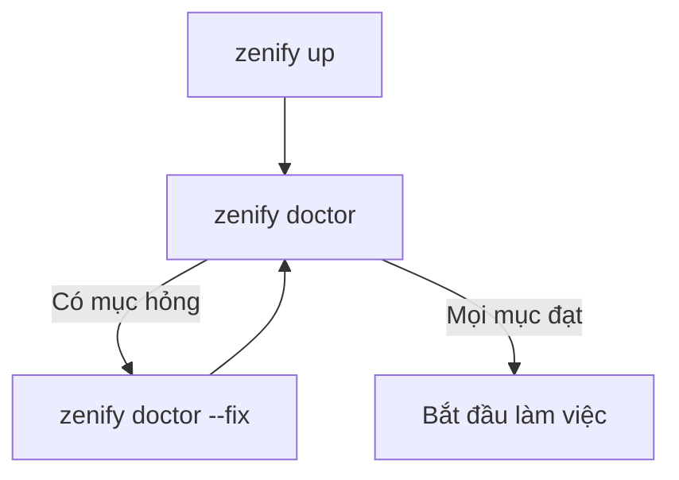

# Onboard workspace và repo

Trang này gom lại các lệnh dùng khi đưa một máy mới vào workspace, hoặc khi sửa lại layout repo trên một workspace đã có. Với luồng đầy đủ từng bước, đọc [Bắt đầu nhanh](/getting-started/quickstart) trước.

## Khi nào dùng

Dùng các lệnh ở đây khi cài ZenifyKit trên một máy mới, khi team thêm repo và bạn cần kéo về đúng bộ, khi cần kiểm tra môi trường đang thiếu gì, hoặc khi một workspace cũ có repo nằm rải ở gốc và cần chuyển sang layout `repos/<tên>`.

## Các bước



*Trình tự onboard một máy mới*

`zenify up` chạy an toàn nhiều lần: mỗi lần chạy lại nó chỉ sửa những gì lệch so với cấu hình chung của team, không ghi đè việc bạn đã tự chỉnh.

## Lệnh

### `zenify up`

Onboard máy vào workspace. Chạy trong terminal, lệnh mở wizard: chọn thư mục workspace, chọn repo bạn có quyền truy cập, rồi, với manifest không khai báo `broker:`, nhập các key toàn cục vào `<workspace>/.zenify/.env`. Khi manifest khai báo `broker:`, credential DB, E2E và PostHog đi qua broker và wizard không hỏi các key đó; xem [Dùng credential broker](/guides/broker-client).

Khi apply, lệnh clone repo còn thiếu, ghi các file cấu hình do kit sở hữu, gắn hook `znf` vào `~/.claude/settings.json`, đồng bộ plugin skill, chuẩn bị Playwright nếu workspace có repo frontend, cài extension `gh-stack` nếu thiếu (`gh extension install github/gh-stack`, lỗi chỉ cảnh báo), clone knowledge store và ghi con trỏ workspace vào `~/.zenify/workspace`. Với Playwright, lệnh cài `@playwright/cli@0.1.22` (ghim phiên bản) vào `~/.zenify/playwright/cli/pkg` và Chromium revision 1247 qua đúng gói đó, nên trình duyệt chỉ tải lại khi kit nâng pin, tiến trình tải hiện ngay trên terminal; khi đúng bản Chromium đó đã cài xong, lệnh bỏ qua bước cài và in `chromium <revision> already installed`. `znf:ui-verifier` điều khiển trình duyệt qua `zenify browser`, mỗi verifier một phiên riêng nên chạy song song được. Lệnh gỡ Playwright MCP do kit từng đăng ký (ở mọi workspace, cả Claude và Codex khi `codex` có trên PATH), còn đăng ký bạn tự cấu hình thì giữ nguyên và lệnh in một dòng báo giữ; lệnh cũng bỏ các rule `mcp__playwright__*` kit từng thêm vào `permissions.allow`. Lệnh thêm vào `permissions.allow` của `~/.claude/settings.json` rule `Bash(zenify browser *)` mà `znf:ui-verifier` dùng, cùng `Bash(zenify e2e *)` và `Bash(zenify visual *)` và `Bash(zenify ui-verify *)`, nên verify UI không hỏi quyền. Lệnh cũng thêm `Bash(zenify db-read *)`, `Bash(zenify redis-read *)` và `Bash(zenify data run *)` vào `permissions.allow`, và `zenify db-read *`, `zenify redis-read *`, `zenify data run *` vào `sandbox.excludedCommands`, vì ba lệnh này gọi broker và lệnh con của `data run` nối thẳng tới DB. Lệnh con sau `--` của `data run` vì vậy chạy không hỏi quyền và ngoài sandbox; git-guard vẫn xét lệnh con, còn ghi production vẫn cần role lead ở broker và dry-run trước. Riêng ghi production thì có hỏi: lệnh thêm `Bash(zenify *data run*--prd*--write*)` và `Bash(zenify *data run*--write*--prd*)` vào `permissions.ask`, nên mọi lệnh `data run` có cả `--prd` lẫn `--write` hiện prompt kể cả khi bật bypass (rule ask thắng rule allow). Lệnh cũng thêm `Bash(ssh *)` vào `permissions.ask`: lệnh chạy trên server nằm ngoài tầm git-guard và không hoàn tác được, nên mỗi lần `ssh` đều hỏi. `zenify down` gỡ các rule ask này cùng các mục kit khác. Lệnh cũng thêm vào `permissions.allow` cho stacked PR đúng các lệnh `gh stack` mà skill dùng: `Bash(gh stack --help)` và `Bash(gh stack <lệnh> *)` với `init`, `add`, `checkout`, `rebase`, `push`, `submit`, `view`; lệnh `gh stack` khác vẫn hỏi quyền. Lệnh cũng thêm `zenify e2e login *` và `zenify browser *` vào `sandbox.excludedCommands`, vì sandbox Bash chặn `zenify e2e login` ghi `~/.zenify` và gọi app local, còn `zenify browser` chạy Chromium và ghi vào thư mục phiên; các lệnh `zenify e2e` khác vẫn chạy trong sandbox. Tương tự, `gh stack <lệnh> *` với bảy lệnh đó cũng được thêm vào `sandbox.excludedCommands` vì chúng đọc auth của `gh` và gọi GitHub, cả hai đều bị sandbox chặn; lệnh `gh stack` khác vẫn chạy trong sandbox, và git-guard vẫn chặn merge, gỡ, ghép stack và `gh stack alias` trước mọi rule quyền. Khi bạn không bật sandbox, mục này không có tác dụng. `zenify down` chỉ gỡ các mục kit đã thêm, mục bạn có từ trước vẫn còn; luật deny `.zenify/.env` của workspace đó do kit thêm bị gỡ khỏi `~/.claude/settings.json`, luật deny bạn tự thêm và luật của workspace khác giữ nguyên. Mục kit mà bạn đã tự xoá khỏi `permissions.allow` hoặc `sandbox.excludedCommands` sẽ không bị thêm lại. Lệnh cần `gh` đã đăng nhập với scope `read:org` và `repo`.

Credential nằm ở `<workspace>/.zenify/.env`, không còn là placeholder trong khối `env` của settings; `zenify up --apply` dựng file thành khung có sẵn mọi key của manifest (key trống là `KEY=`), chia mục Staging, Tooling, Production, Custom; wizard chỉ hỏi các key toàn cục, bỏ nhóm production. Key không có trong manifest, ví dụ `OPENROUTER_API_KEY`, là key custom, thêm bằng `zenify env set OPENROUTER_API_KEY --desc "key cá nhân"`. `zenify up --apply` chuyển key manifest còn nằm trong khối `env` của `settings.local.json` sang file mới và thêm luật deny `Read(//<workspace>/.zenify/.env)` (đường dẫn tuyệt đối) vào `~/.claude/settings.json`. Chi tiết và quy tắc khi hai giá trị khác nhau: [Credential dev với zenify env](/guides/env).

Khi một repo trong workspace cài package từ GitHub Packages (`.npmrc` trỏ tới `npm.pkg.github.com` và đọc token từ `${NPM_TOKEN}`), `zenify up` thêm một dòng `export NPM_TOKEN="${NPM_TOKEN:-$(gh auth token 2>/dev/null)}" # zenify-npm-token` vào profile shell (`~/.zshrc`, hoặc `~/.bashrc`/`~/.profile` với bash) để shell mới có `NPM_TOKEN`; `NPM_TOKEN` đã có sẵn trong môi trường thì được giữ nguyên. Sau đó chạy `source <profile>` hoặc mở terminal mới trước khi `npm install`. Token không được ghi ra đĩa hay in ra, nhưng đó là toàn bộ token của `gh auth token` (mọi scope `gh` đang giữ, không chỉ `read:packages`) và được export cho mọi shell mới. Nếu `gh` chưa có scope `read:packages`, `zenify up` chạy `gh auth refresh -h github.com -s read:packages` khi có TTY, còn với `--non-interactive` hoặc không có TTY thì in lệnh để bạn tự chạy. Profile đã tự đặt `NPM_TOKEN` thì giữ nguyên; shell khác zsh/bash thì lệnh in dòng trên để bạn tự thêm. `zenify down` không gỡ dòng `# zenify-npm-token`, hãy xoá tay nếu không cần nữa. Khi thiếu `NPM_TOKEN`, mục `npm token (GitHub Packages)` của `zenify doctor` báo hỏng, nên `zenify doctor --exit-on-fail` thất bại cho tới khi sửa xong. Muốn chạy lại riêng phần này, dùng `zenify npm login`: lệnh luôn chạy, kể cả khi không có repo nào cần GitHub Packages.

```bash
zenify up
zenify up --non-interactive --dry-run --workspace ~/WorkingSpace/zenify
zenify up --non-interactive --apply --workspace ~/WorkingSpace/zenify
```

| Cờ | Ý nghĩa |
|---|---|
| `--apply` | Thực thi kế hoạch. Không kèm cờ này và không ở terminal, lệnh chỉ in kế hoạch |
| `--dry-run` | Chỉ in kế hoạch, không đổi gì. Mặc định khi chạy ngoài terminal |
| `--non-interactive` | Không mở wizard kể cả khi đang ở terminal. Dùng trong script |
| `--workspace` | Thư mục workspace |

### `zenify down`

Gỡ phần ZenifyKit đã cài vào máy và repo, giữ nguyên code, workspace và knowledge store. Đây là bước đảo của `zenify up`. Mặc định chỉ in preview, thêm `--apply` để thực thi. Lệnh không đụng vào repo đã clone hay knowledge store.

```bash
zenify down
zenify down --apply
```

### `zenify doctor`

Kiểm tra sức khỏe môi trường và báo từng mục đạt hay hỏng: phiên bản binary, đăng nhập git và quyền GitHub, danh tính commit của git (`user.name`, `user.email`), mục `npm token (GitHub Packages)` (chỉ áp dụng khi có repo cài từ GitHub Packages: báo `gh` thiếu scope `read:packages`, chưa đăng nhập, hoặc `NPM_TOKEN` chưa có; sửa bằng `zenify doctor --fix` hoặc `zenify npm login`; mục này chỉ xét account github.com đang active của `gh` và báo `gh auth status timed out` nếu `gh auth status` không trả lời sau 10 giây), credential trong `.zenify/.env` (`secrets` báo theo tên key toàn cục (trừ nhóm production) có giá trị hay trống, `env-file` báo quyền rộng hơn 0600 và key custom chưa có mô tả, `settings-env` báo theo tên key còn nằm trong settings), mục `broker-creds` (xin thử credential staging từ broker, báo tên biến nhận được; bỏ qua khi không có broker), tool bên ngoài (`git`, `gh`, `mongosh`, `mysql`), Playwright (mục `playwright`: `@playwright/cli` đã cài và Chromium đúng revision, chỉ đọc nên không mở trình duyệt; báo hỏng nếu MCP `playwright` do kit đăng ký vẫn còn, còn đăng ký bạn tự cấu hình không làm mục này hỏng), quyền `zenify browser`/`zenify e2e`/`zenify visual`/`zenify ui-verify` trong `permissions.allow`, mục `gh-stack` (cần `gh` từ 2.90.0 và extension `github/gh-stack`; `zenify doctor --fix` cài extension nếu thiếu bằng `gh extension install github/gh-stack`), Docker và plugin skill `znf`. Doctor cũng kiểm tra `tmux` từ 3.1 trở lên, tool mà `zenify hub` cần: thiếu `tmux` hoặc phiên bản cũ hơn 3.1 làm doctor báo không khỏe. `zenify doctor --fix` cài `tmux` cho bạn: trên macOS dùng `brew`; trên Linux thử lần lượt `apt-get`, `dnf` rồi `brew`, chạy qua `sudo`. Khi không có terminal để `sudo` hỏi mật khẩu, `--fix` không chạy `sudo` mà in ra lệnh cài để bạn tự chạy. `zenify up` không cài `tmux`, chỉ in gợi ý khi thiếu. Chạy ngay sau `zenify up`, và mỗi khi một skill báo thiếu tool hoặc thiếu secret. Lệnh chỉ đọc, chạy bao nhiêu lần cũng được.

```bash
zenify doctor
zenify doctor --fix
```

| Cờ | Ý nghĩa |
|---|---|
| `--fix` | Tự sửa các mục an toàn rồi kiểm tra lại. Mục cần bạn tự làm vẫn in hướng dẫn |
| `--exit-on-fail` | Trả mã thoát khác 0 khi có mục hỏng, dùng trong script và CI |
| `--json` | In kết quả dạng JSON |

### `zenify migrate`

Gom các repo đang nằm rải ở gốc workspace vào thư mục con `repos/<tên>`, layout mà `zenify up` dùng. Chạy một lần khi workspace cũ chưa theo layout này.

```bash
zenify migrate
zenify migrate --apply
```

Mặc định lệnh chỉ liệt kê từng repo với hành động `Move`, `Refuse` hoặc `Skip` kèm lý do. Với `--apply`, lệnh di chuyển repo, sửa lại liên kết worktree, trỏ lại symlink `node_modules` và cập nhật đường dẫn trong manifest workspace, rồi nhắc bạn khởi động lại dev server đang chạy. Repo còn thay đổi chưa commit hoặc có worktree đang mở bị đánh `Refuse`.

### `zenify update`

Nâng cấp binary lên bản mới nhất bằng đúng kênh đã cài (Homebrew, Scoop, hoặc script cài đặt), hoặc chỉ kiểm tra có bản mới với `--check`. Đầu mỗi phiên, binary tự in dòng `zenify: vX is available` khi có bản mới; đặt `ZENIFY_NO_UPDATE_CHECK=1` để tắt dòng nhắc này.

```bash
zenify update --check
zenify update
```

## Cấu hình worktree của một repo

Mỗi repo tham gia workspace khai báo một file `.claude/worktree.json`, ví dụ của `zenify-kit`:

```json
{
  "abbrev": "kit",
  "baseRef": "origin/main",
  "worktreeDir": ".worktrees/",
  "copy": [".claude/settings.local.json"],
  "deps": "none",
  "portEnv": "PORT",
  "portRange": [3750, 3799]
}
```

| Trường | Ý nghĩa |
|---|---|
| `abbrev` | tên viết tắt của repo |
| `baseRef` | branch gốc mặc định cho `zenify wt new --type feat/fix` |
| `hotfixBaseRef` | base ref riêng cho `--type hotfix`, nếu khác `baseRef` |
| `worktreeDir` | thư mục chứa các worktree, thường `.worktrees/` |
| `copy` | các file được seed từ checkout chính vào worktree mới, ví dụ `.claude/settings.local.json` và `CLAUDE.md`. Nhờ seed `.claude/settings.local.json`, worktree dùng chung secret và bộ nhớ với checkout chính, xem [Secret và settings.local.json](/guides/read-real-data#secret-va-settings-local-json) |
| `deps` | cách seed dependency: `symlink`, `clone`, hoặc `none` cho repo không phải Node |
| `install` | lệnh cài dependency khi `deps` cần cài riêng |
| `portEnv` | tên biến môi trường worktree đọc port từ đó |
| `portRange` | khối port riêng của repo, không trùng repo khác trong workspace |

Chi tiết cách chọn `baseRef`, `hotfixBaseRef` và dải port cho repo mới: [Base ref và port block](/concepts/base-ref-and-ports).

## Kết quả

`.worktrees/` phải nằm trong `.gitignore` đã commit của mỗi repo, không nằm trong `.git/info/exclude`. Khai báo cục bộ không đi theo repo, nên đồng nghiệp clone lần đầu sẽ thấy checkout bị bẩn ngay khi chạy `zenify wt new`.

## Lưu ý

- `zenify up` chạy lại được bất cứ lúc nào, kể cả sau khi team thêm repo mới.
- Repo không phải Node vẫn onboard bình thường, chỉ cần `.claude/worktree.json` khai `"deps": "none"` và một khối port riêng.

## Xem thêm

[`zenify up`](/reference/cli/zenify_up), [`zenify doctor`](/reference/cli/zenify_doctor), [`zenify npm login`](/reference/cli/zenify_npm_login), [`zenify migrate`](/reference/cli/zenify_migrate), [`zenify down`](/reference/cli/zenify_down), [`zenify update`](/reference/cli/zenify_update), [Bắt đầu nhanh](/getting-started/quickstart), [Base ref và port block](/concepts/base-ref-and-ports)

<!-- Nguồn (cho người bảo trì, không hiển thị):
- reference/cli/zenify_up.md, zenify_down.md, zenify_doctor.md, zenify_migrate.md, zenify_update.md (generated)
- concepts/base-ref-and-ports.md (worktree.json field example và ý nghĩa)
-->
