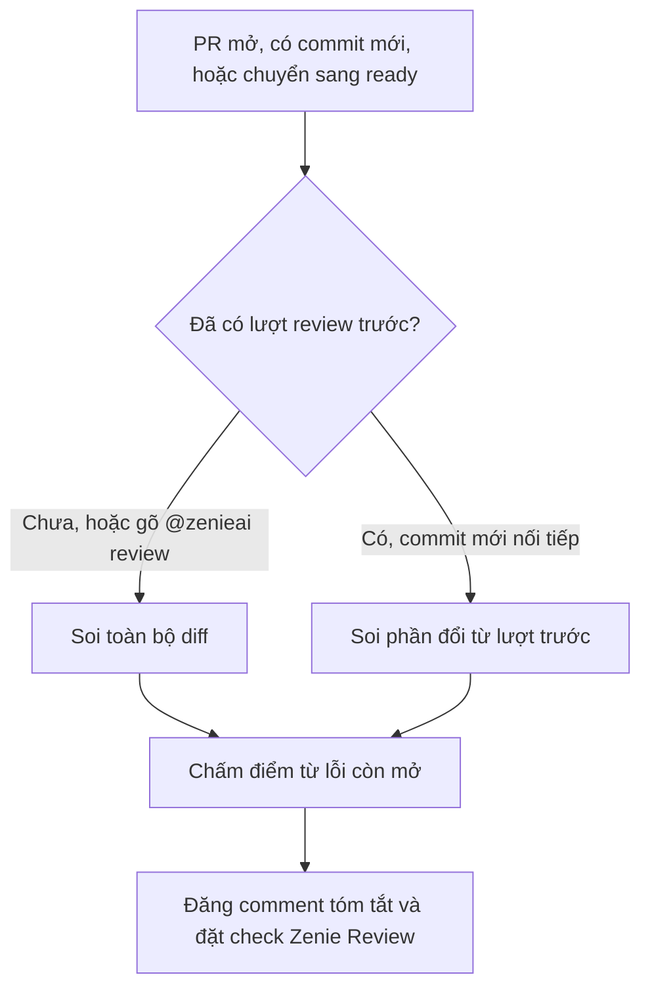

# Zenie review trên PR

Mỗi PR mở trong org được Zenie review tự động: Zenie đăng một comment tóm tắt "Zenie review", gắn comment theo dòng cho từng lỗi, và đặt check `Zenie Review` trên commit mới nhất. Trang này giải thích Zenie chấm điểm thế nào, check xanh hay đỏ khi nào, và bạn gõ được những lệnh nào trên PR.

## Khi nào Zenie review

Zenie review khi PR được mở, mở lại, có commit mới, hoặc chuyển từ draft sang ready. PR draft không được review; chuyển PR về draft hoặc đóng PR thì lượt đang chờ bị hủy.

Hai loại PR không được review tự động, check `Zenie Review` khi đó là `neutral` để không chặn merge:

- PR đồng bộ nhánh, tức nhánh nguồn là `staging`, `main`, `master`, `develop`, `development-2`, `production` hoặc `release<N>`. Cần review thì comment `@zenieai review`.
- PR mở từ fork.

*Một lượt Zenie review*

## Soi toàn bộ hay soi phần đổi

Lượt đầu tiên luôn "soi toàn bộ". Các lượt sau "soi phần đổi" từ commit đã review trước đó, với điều kiện commit mới nối tiếp commit cũ; nếu lịch sử bị viết lại (rebase, force-push) thì Zenie soi lại toàn bộ. `@zenieai review` luôn soi toàn bộ. Dòng cuối comment tóm tắt ghi rõ lượt này thuộc loại nào.

Khi soi phần đổi, một lỗi CRITICAL hoặc HIGH mới nằm ngoài các dòng vừa đổi vẫn được báo, kèm hậu tố "(báo muộn)" ở tiêu đề; lỗi MEDIUM ngoài phần đổi bị bỏ.

Diff giống hệt lượt trước (sau rebase) hoặc chỉ đổi tài liệu thì Zenie giữ kết quả cũ, không soi lại. Diff có trên 1000 dòng code (không tính file test) được chia thành nhiều bó, mỗi bó tối đa khoảng 800 dòng; comment ghi "Review theo N bó".

Reviewer không cài dependency và không chạy test, build hay typecheck của repo. Việc chạy test thuộc về CI của repo và người kiểm.

## Mức độ lỗi

| Nhãn | Ý nghĩa với merge |
|---|---|
| 🔴 **CRITICAL** | Luôn chặn merge |
| 🟠 **HIGH** | Chặn merge, trừ khi được đánh dấu "không chặn merge" |
| 🟡 **MEDIUM** | Không chặn merge |

Sau khi PR đã qua 2 lượt review có lỗi CRITICAL/HIGH chặn merge, các lỗi HIGH *mới* phát hiện từ đó trở đi chỉ mang tính tham khảo: vẫn hiển thị, ghi "không chặn merge", người merge tự quyết. Lỗi HIGH đã mở từ trước vẫn chặn. Lỗi CRITICAL và lỗi thuộc nhóm bảo mật luôn chặn.

## Điểm trên comment

Tiêu đề comment có dạng `Zenie review · <điểm>/5 · <việc cần làm>`. Điểm tính theo công thức cố định từ các lỗi còn mở, không do model tự cho:

| Điểm | Khi nào | Việc cần làm |
|---|---|---|
| 1/5 | Có lỗi CRITICAL | Xem lại cách làm |
| 2/5 | Từ 2 lỗi HIGH | Sửa lỗi trước khi merge |
| 3/5 | 1 lỗi HIGH | Sửa lỗi trước khi merge |
| 4/5 | Chỉ còn lỗi MEDIUM hoặc HIGH không chặn | Sửa nhỏ rồi merge |
| 5/5 | Không còn lỗi mở | Merge được |

Lỗi đã sửa hoặc đã `Declined:` không tính vào điểm. Mục "Cần người kiểm trước khi merge" liệt kê những điểm Zenie không tự xác minh được; mục này không làm giảm điểm. Dòng "Zenie không chạy được" cho biết phần nào reviewer không thực hiện được trong lượt đó.

## Check `Zenie Review`

| Kết luận | Khi nào |
|---|---|
| `success` | Không còn lỗi CRITICAL/HIGH chặn merge; nếu còn HIGH không chặn, tiêu đề check nhắc đọc trước khi merge |
| `failure` | Còn lỗi CRITICAL/HIGH chặn merge, PR sửa file hướng dẫn agent, hoặc Zenie chưa review xong |
| `neutral` | PR đồng bộ nhánh hoặc PR từ fork, Zenie không review |
| `cancelled` | PR bị đóng, chuyển về draft, hoặc có commit mới thay lượt này |

PR sửa file hướng dẫn agent luôn nhận `failure` với tiêu đề "PR sửa file hướng dẫn agent — cần người xem", bất kể có lỗi hay không. File hướng dẫn gồm `AGENTS.md`, `AGENTS.override.md`, `CLAUDE.md` ở bất kỳ thư mục nào (không phân biệt hoa thường), và mọi file nằm trong thư mục `.claude/` hoặc `.codex/`.

Khi Zenie chưa review xong (lỗi giữa chừng, hoặc vẫn hết giờ sau khi đã chia nhỏ diff), check có tiêu đề "Zenie chưa review xong", kèm lý do và danh sách file chưa được review. Gõ `@zenieai review` để chạy lại, hoặc nhờ leader merge qua bypass.

## Lệnh trên PR

Comment phải bắt đầu bằng `@zenieai`, do thành viên org viết, trên PR đang mở, không phải draft và không phải từ fork.

| Lệnh | Tác dụng |
|---|---|
| `@zenieai review` (hoặc `@zenieai` một mình) | Soi lại toàn bộ PR |
| `@zenieai fix` | Giao PR cho Zenie tự sửa và sửa ngay các lỗi còn mở của lượt review mới nhất |
| `@zenieai stop` | Tắt tự sửa cho PR này; lượt đang chạy (nếu có) vẫn chạy nốt |

Với `review` và `stop`, Zenie thả 👀 lên comment lệnh khi đã nhận. Một từ khác sau `@zenieai` nhận lại danh sách lệnh trên.

### Bỏ qua một lỗi bằng `Declined:`

Viết một dòng có dạng `Declined: <tiêu đề> — <lý do>` trong comment trên PR, hoặc trả lời ngay trong luồng comment theo dòng của Zenie. Dòng phải bắt đầu đúng bằng `Declined:` ở đầu dòng. Zenie so khớp theo tiêu đề lỗi (không phân biệt hoa thường và dấu), và chỉ áp cho lỗi đã báo ở các lượt trước.

Comment `Declined:` không tự kích hoạt lượt review: điểm chỉ cập nhật ở lần push kế tiếp hoặc khi gõ `@zenieai review`. `@zenieai fix` thì đọc các dòng `Declined:` ngay lúc chạy.

## Tự sửa với `zenie-dev`

Khi một lượt review còn lỗi có thể sửa, hoặc CI đỏ trên commit hiện tại, Zenie giao việc cho `zenie-dev` và hiện check `zenie-dev` trên PR.

- Lỗi được sửa: CRITICAL và HIGH còn mở; MEDIUM chỉ khi server bật `ZENIE_AUTOFIX_MEDIUM`. Lỗi không chặn, lỗi đã `Declined:` và lỗi `zenie-dev` từng phản bác không được giao.
- PR do `zenie-dev` mở được tự sửa tự động. PR của người chỉ được tự sửa khi server bật `ZENIE_AUTOFIX_HUMAN` và tác giả đã gõ `@zenieai fix`; PR đó còn phải đang mở, không phải draft, không từ fork, và nhánh nguồn không phải nhánh deploy.
- Mỗi PR có tối đa 3 vòng tự sửa tự động, dùng chung cho lỗi review và CI đỏ. `@zenieai fix` vẫn chạy được khi đã hết 3 vòng.
- Chỉ áp cho các repo mà agent được phép sửa.
- Bạn push lên PR trong lúc `zenie-dev` đang sửa thì `zenie-dev` dừng và không tự sửa PR đó nữa cho tới khi có `@zenieai fix` mới.

## Reaction trên PR

Zenie giữ một bộ reaction trên chính PR, thay bộ cũ mỗi khi trạng thái đổi:

| Reaction | Ý nghĩa |
|---|---|
| 👀 | Đang review, hoặc review xong và còn lỗi HIGH không chặn |
| ❤️ 👍 | Review xong, check `success` |
| 😕 | Review xong với check `failure`, hoặc tự sửa đã hết vòng hay cần người xem |
| 🚀 | Đã xếp một vòng tự sửa của `zenie-dev` |
| 🎉 ❤️ | Review đạt và mọi GitHub Actions của commit đều xanh; dev phụ trách nhận tin nhắn Telegram báo PR sẵn sàng merge |

Khi một lượt review lỗi giữa chừng, Zenie gỡ hết reaction của mình.

## Lưu ý

- Zenie không bao giờ merge PR. Merge luôn là quyết định của người.
- Check xanh không thay thế CI và bước kiểm tra hành vi; Zenie chỉ đọc code.

## Xem thêm

[Review và gate](/guides/review-and-gates), [ship: verify và mở PR](/workflows/ship)

<!-- Nguồn (cho người bảo trì, không hiển thị): repo zenie origin/main
- src/review/verdict.ts, rounds.ts, runner.ts, bundles.ts, pack.ts
- src/intake/pipeline.ts, zenie-command.ts, src/copy.ts (SKIP_CHECK)
- src/agent/loop.ts, results.ts, src/github/app.ts
- deploy/reviewer/review-prompt.md
-->
