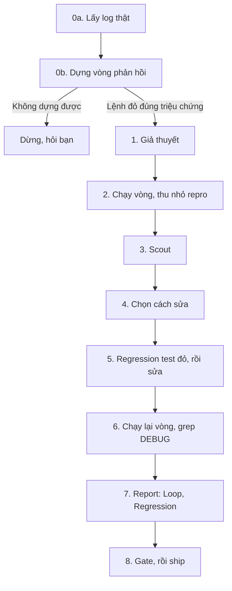

# fix: sửa lỗi chưa rõ nguyên nhân

`/znf:fix` là workflow tìm nguyên nhân và sửa một lỗi. Nó lấy log thật, dựng một lệnh tái hiện đỏ trước khi đoán, chứng minh nguyên nhân, thêm regression test rồi sửa, sau đó gọi `/znf:gate` và `/znf:ship`.

## Khi nào dùng

Dùng `/znf:fix` khi:

- Có triệu chứng thật (log, lỗi, test fail) và chưa biết nguyên nhân.
- Cần chứng minh nguyên nhân trước khi sửa.

Không dùng `/znf:fix` khi:

- Đang hỏng trên production. Dùng [`/znf:hotfix`](/workflows/hotfix). Hotfix dùng lại bước chẩn đoán của fix.
- Đã biết nguyên nhân và cách sửa chỉ một dòng. Đi đường không dùng workflow, xem [Chọn workflow](/workflows/).

## Cách gọi

```text
/znf:fix <mô tả triệu chứng>
/znf:fix <url github-actions-run>
/znf:fix
```

Không truyền gì thì fix tự lấy log gần nhất. Agent tự route vào `/znf:fix` khi nhận bug report. Điểm này khác với hotfix.

## Viết yêu cầu

| Trường | Ví dụ |
|---|---|
| Triệu chứng nguyên văn | Đúng dòng log hoặc lỗi thật, không diễn giải lại |
| Cách tái hiện | Bước cụ thể, hoặc "không tái hiện được, chỉ có log" |
| Mong đợi | Hành vi đúng phải là gì |
| Môi trường | Repo, branch hoặc base, local hay staging |
| Từ khi nào | Mới xuất hiện hay đã có từ lâu |

## Các bước



*Các bước của một lần chạy fix*

| Bước | Kit làm gì | Bạn làm gì |
|---|---|---|
| 0 | Lấy log hoặc lỗi thật, rồi dựng vòng phản hồi: đúng một lệnh có tên, đã chạy, đỏ đúng triệu chứng bạn mô tả (thang các cách dựng nằm trong `references/feedback-loop.md`). Với triệu chứng trên staging hoặc production, nguồn bằng chứng được tra theo thứ tự log, trace, `db-read`/`redis-read`, PostHog, theo tài liệu tham chiếu chung `_shared/evidence-sources` (xem [Quan sát và an toàn](/guides/observe-and-safety#nguon-bang-chung-cho-agent)). Secret, dữ liệu cá nhân của khách hàng và id tenant/account được lọc thành `<REDACTED>` ngay trong lệnh | Xác nhận đúng log. Nếu không dựng được vòng, kit dừng và xin môi trường tái hiện, artifact đã che secret, hoặc quyền thêm log tạm. Bậc cuối của thang (bạn làm theo các bước thủ công rồi dán dòng `KEY=value`) chỉ dành cho bước trên UI hoặc thiết bị; đọc DB hay chạy script dữ liệu thì agent tự chạy `zenify db-read`, `redis-read` hoặc `zenify data run` |
| 1 | Phân tích nguyên nhân. Hẹp thì một giả thuyết, rộng thì nhiều agent chạy song song, mỗi agent nhận lệnh đỏ cùng giả thuyết của nó | Đọc kết luận |
| 2 | Chạy lệnh đỏ, xác nhận lỗi đúng triệu chứng rồi thu repro về kịch bản nhỏ nhất vẫn đỏ. Kiểm chứng nguyên nhân trước khi sửa bất cứ gì | Không sửa gì nếu chưa kiểm chứng được |
| 3 | Chạy `/znf:scout` tìm nơi gọi, đọc, ghi code sắp đổi | Đọc báo cáo scout |
| 4 | Nếu có trade-off thật giữa hai cách sửa, trình bày cho bạn | Chọn cách sửa |
| 4 (leo thang) | Nếu fix lan 4+ file hoặc cần quyết định thiết kế, dừng | Chuyển sang `/znf:cook` thay vì ép sửa trong fix |
| 5 | Tự chọn seam (chỗ test chạy lỗi đúng như nơi gọi thật), biến repro thành regression test, xác nhận test fail, rồi sửa nhỏ nhất theo cách đã chọn. Không có seam thì ghi `no seam: <lý do>` | Không cần làm gì. Kit không hỏi bạn về seam |
| 6 | Chạy lại vòng trên kịch bản gốc, kỳ vọng xanh. Xoá mọi log `[DEBUG-xxxx]` và grep lại để chắc không sót | Đọc kết quả |
| 7 | Ghi báo cáo gồm nguyên nhân, cách sửa, `Loop:` (lệnh, đỏ rồi xanh) và `Regression:` (tên test hoặc `no seam`) | Đọc báo cáo |
| 8 | Chạy `/znf:gate` rồi `/znf:ship` | Đọc board ship, nhận PR |

## Kết quả

| Artifact | Nội dung |
|---|---|
| Báo cáo | Nguyên nhân đã xác nhận, cách sửa, lệnh vòng phản hồi (đỏ rồi xanh), regression test hoặc lý do không có seam, kết quả verify |
| Branch | `<user>/fix/<slug>` |
| PR | Mở, chưa merge |

## Worktree

Worktree được tạo trước lần ghi file đầu tiên của vòng phản hồi (test, harness, log debug) hoặc trước lần khởi động server, chậm nhất trước bước 5. Các cách chỉ đọc (đọc log, chạy test có sẵn đang fail, request GET/HEAD vào môi trường đang chạy) không cần worktree. Request có side effect hoặc replay payload chỉ chạy trên port của worktree hoặc target local; ghi vào môi trường dùng chung hay production đi qua `zenify data run`: agent tự chạy dry-run trước rồi `--write`; production chỉ lead chạy được. Xem [Dùng credential broker](/guides/broker-client#data-run).

## Quyết định thuộc về bạn

- Có leo thang sang `/znf:cook` hay không, khi fix vượt quá phạm vi một bug.
- Chọn cách sửa khi có trade-off thật giữa hai lựa chọn hợp lý.
- Merge PR.

## Ví dụ

Một fix thật trong chính ZenifyKit.

Triệu chứng: sau `zenify migrate`, một worktree cũ còn thư mục và branch nhưng git không còn đăng ký nó. `zenify wt rm --force` và `zenify wt sweep` báo lỗi khi gọi git, không dọn được gì.

Nguyên nhân: sau khi di chuyển repo, worktree cũ trỏ tới vị trí git đã bỏ, nên git không còn nhận nó.

Cách sửa: khi git không còn biết worktree đó, kit xoá thư mục trực tiếp, dọn dấu vết trong git và vẫn xoá đúng branch. Fix nằm gọn trong lệnh `wt`, không đổi hành vi khác.

## Lỗi thường gặp

| Tránh | Nên làm |
|---|---|
| Vá triệu chứng cho qua | Chứng minh nguyên nhân bằng bằng chứng thật ở bước 2 trước khi sửa |
| Đoán giả thuyết khi chưa có lệnh đỏ | Dựng vòng phản hồi ở bước 0 trước. Không dựng được thì dừng và xin thêm dữ liệu, không đoán |
| Dán log hoặc payload thô vào hội thoại | Lọc ngay trong lệnh: token, mật khẩu, API key, cookie, chuỗi kết nối, dữ liệu cá nhân khách hàng, id tenant/account thành `<REDACTED>`; fixture dùng dữ liệu giả |
| Để fix mọc thành feature | Fix lan 4+ file hoặc cần quyết định thiết kế thì leo thang sang `/znf:cook` |

## Xem thêm

[`/reference/skills/fix`](/reference/skills/fix), [Chọn workflow](/workflows/)

<!-- Nguồn (cho người bảo trì, không hiển thị):
- internal/plugin/assets/znf/skills/fix/SKILL.md @ b296ca1
- Ví dụ: commit c8a7eea fix(wt): delete orphan worktree dirs git no longer registers (origin/main), 3 file, +119/-2
-->
