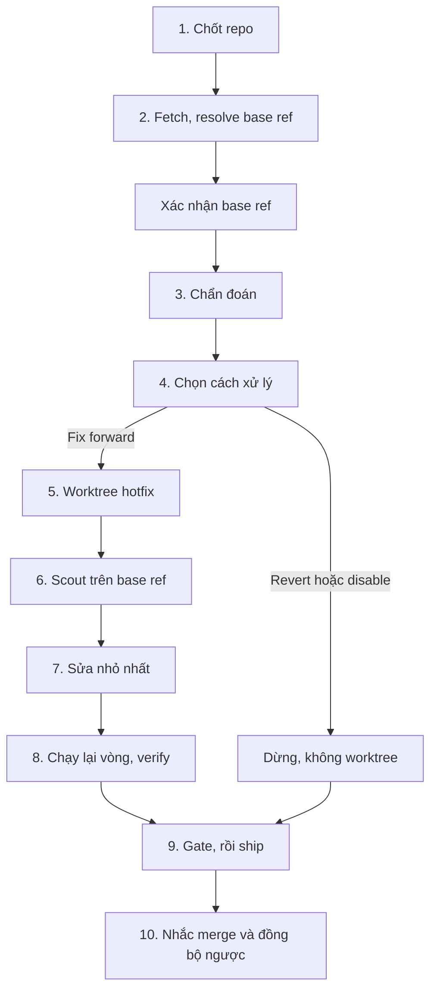

# hotfix: sửa lỗi trên production

`/znf:hotfix` là workflow sửa lỗi đang ảnh hưởng production. Nó branch từ base hotfix mà repo khai trong `worktree.json` (ví dụ `origin/main`), dùng lại bước chẩn đoán của `/znf:fix`, và để bạn chọn giữa revert, disable hoặc fix forward.

## Khi nào dùng

Dùng `/znf:hotfix` khi lỗi đang ảnh hưởng production và bạn xác nhận độ khẩn.

Không dùng `/znf:hotfix` khi lỗi chỉ xảy ra trên staging hoặc dev. Dùng [`/znf:fix`](/workflows/fix).

## Cách gọi

```text
/znf:hotfix <mô tả ngắn>
```

Chỉ bạn gõ được `/znf:hotfix`. Agent không tự gọi được lệnh này, chỉ đề xuất. Độ khẩn là quyết định của bạn.

## Viết yêu cầu

| Trường | Ví dụ |
|---|---|
| Repo | Repo đang chạy bản lỗi |
| Base hotfix | Ref mà production đang chạy, do `zenify hotfix baseref` in ra |
| Ảnh hưởng | Ai hoặc luồng nào đang bị chặn |
| Bằng chứng | Log, trace hoặc metric thật, ticket |

## Các bước



*Các bước của một lần chạy hotfix*

| Bước | Kit làm gì | Bạn làm gì |
|---|---|---|
| 1 | Chốt repo bị ảnh hưởng | Xác nhận đúng repo |
| 2 | `fetch` rồi resolve base ref hotfix bằng `zenify hotfix baseref` | Xác nhận đây đúng là bản đang chạy production |
| 3 | Chẩn đoán bằng bước 0-2 của `/znf:fix`. Ở bước này agent tự chạy các cách tái hiện chỉ đọc trên production và lọc output thành `<REDACTED>`; cách nào có side effect thì đi qua `zenify data run` (dry-run trước, chờ "ok" của bạn trước `--prd --write`); nếu không có thì xác nhận nguyên nhân từ log, không dừng và không thêm log tạm trên production. Nguồn bằng chứng (log, trace, metric, `db-read`/`redis-read`, PostHog) và thứ tự tra cứu lấy từ tài liệu tham chiếu chung `_shared/evidence-sources`, xem [Quan sát và an toàn](/guides/observe-and-safety#nguon-bang-chung-cho-agent) | Đọc nguyên nhân đã xác nhận |
| 4 | Trình bày ba lựa chọn kèm khuyến nghị | Chọn revert, disable hoặc fix forward. Revert và disable dừng tại đây, không tạo worktree |
| 5 | Tạo worktree `--type hotfix --base <base hotfix>` (chỉ khi fix forward) | Không cần làm gì |
| 6 | Chạy `/znf:scout` trên ref đã resolve, không phải base thường ngày | Đọc báo cáo scout |
| 7 | Dựng lệnh đỏ và viết regression test trước (theo bước 5 của `/znf:fix`), xác nhận chúng fail, rồi sửa nhỏ nhất | Không cần làm gì |
| 8 | Chạy lại lệnh đỏ, kỳ vọng xanh, xoá log `[DEBUG-xxxx]` (theo bước 6 của `/znf:fix`), verify trên code path thật | Đọc kết quả |
| 9 | Chạy `/znf:gate` rồi `/znf:ship`, kể cả khi đang gấp. Ship mở PR vào base hotfix | Đọc board ship, nhận PR URL |
| 10 | Nhắc bước tay còn lại | Merge PR (tức là deploy), rồi đồng bộ fix ngược về base feature bằng merge hoặc cherry-pick |
| Sau deploy | Sau khi bạn merge và deploy, kiểm tra kết quả trên đúng vùng fix chạm tới: chỉ chạy các kiểm tra hợp với vùng đó (backend: tỉ lệ lỗi, p95 và số dòng lỗi của route; web: exception PostHog của màn hình; queue: backlog hoặc lag), so cửa sổ trước và sau deploy có độ dài bằng nhau, kèm số request để phân biệt "0 lỗi" với "0 request". Số liệu ghi vào báo cáo hotfix; kiểm tra không chạy được thì ghi là chưa chạy, không ghi là sạch | Đọc số liệu. Triệu chứng chưa giảm hoặc chỉ số lân cận tăng thì chọn lại cách xử lý như bước 4 |

## Kết quả

| Mục | Nội dung |
|---|---|
| Base ref xác nhận | Ref do `zenify hotfix baseref` in ra từ `worktree.json` của repo, ví dụ `origin/main`. Repo chưa khai `hotfixBaseRef` thì lệnh dùng `baseRef` và in cảnh báo; config sai (`release-latest`, `custom` thiếu ref) thì lệnh báo lỗi. Cả hai trường hợp đều sửa `worktree.json`, không đoán tên nhánh |
| Nguyên nhân xác nhận | Kèm bằng chứng thật |
| Cách xử lý đã chọn | Revert, disable hoặc fix forward, kèm lý do |
| Branch (nếu fix forward) | `<user>/hotfix/<slug>` |
| PR | Mở vào base ref hotfix, chưa merge |

## Quyết định thuộc về bạn

- Đây có phải hotfix thật không. Độ khẩn là quyết định của bạn.
- Base ref có đúng là bản đang chạy không.
- Chọn revert, disable hoặc fix forward.
- Merge PR, rồi đồng bộ fix ngược về base feature.

## Ví dụ

Ví dụ minh hoạ, repo khai `"hotfix": {"baseStrategy": "custom"}` và `"hotfixBaseRef": "origin/main"`.

Bản production cắt từ `main` gặp lỗi, xác nhận qua log thật. `zenify hotfix baseref` in `origin/main`, bạn xác nhận và chọn fix forward vì nguyên nhân đã rõ. Kit tạo worktree `--type hotfix --base origin/main`, scout đúng ref đó, dựng lệnh đỏ và viết regression test, sửa, chạy lại lệnh đỏ để verify, gate rồi ship. Ship mở PR vào `main`. Bạn merge rồi đồng bộ fix về base feature (`main → staging`).

## Lỗi thường gặp

| Tránh | Nên làm |
|---|---|
| Resolve base hotfix rồi mới fetch | Luôn `fetch` trước rồi resolve. Nếu không, ref có thể cũ hơn bản đang chạy |
| Fix forward dưới áp lực khi còn phân vân | Chọn revert khi fix forward cần quyết định thiết kế. Lúc gấp không phải lúc thiết kế |
| Quên đồng bộ ngược về base feature | Bước 10 luôn nhắc. Release sau vẫn cần fix này |

## Xem thêm

[`/reference/skills/hotfix`](/reference/skills/hotfix), [Base ref, hotfix base, port block](/concepts/base-ref-and-ports), [Chọn workflow](/workflows/)

<!-- Nguồn (cho người bảo trì, không hiển thị):
- internal/plugin/assets/znf/skills/hotfix/SKILL.md @ b296ca1 (disable-model-invocation: true)
-->
