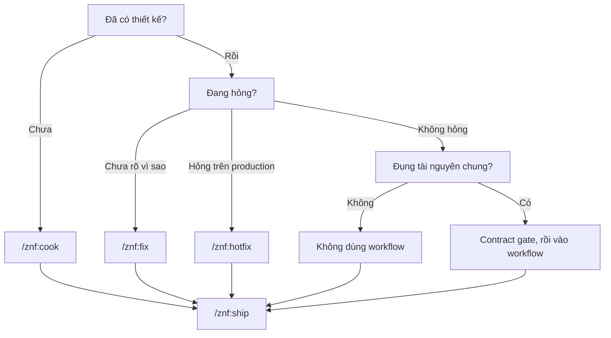

# Chọn workflow

zenify-kit có ba workflow: `/znf:cook`, `/znf:fix` và `/znf:hotfix`. Với thay đổi nhỏ đã rõ yêu cầu, bạn không cần workflow nào, chỉ cần làm trong worktree rồi chạy `/znf:ship`.

Tiêu chí chọn là mức độ bạn đã hiểu về công việc, không phải kích cỡ thay đổi.

## Bảng chọn

| Tình huống | Dùng |
|---|---|
| Chưa có thiết kế, hoặc chưa rõ cần làm gì | `/znf:cook` |
| Có lỗi, chưa biết nguyên nhân | `/znf:fix` |
| Đã biết nguyên nhân, lỗi đang xảy ra trên production | `/znf:hotfix` |
| Đã rõ yêu cầu và cách làm, trong một repo, không chạm tài nguyên chung | Không dùng workflow. Mở worktree, sửa, verify, chạy `/znf:ship` |

*Luồng chọn workflow*

Tài nguyên chung là thứ nhiều service cùng dùng: collection trong DB, endpoint giữa các service, queue, channel pub/sub. Khi thay đổi chạm vào một trong số này, bạn chạy contract gate của project và đi theo workflow thay vì làm trực tiếp.

## Khi nào dùng hotfix

`/znf:cook` và `/znf:fix` phân biệt theo mức hiểu về công việc. `/znf:hotfix` phân biệt theo nơi code sẽ được merge.

Hotfix tạo branch từ release đang chạy, không từ nhánh tích hợp hằng ngày. Phần chẩn đoán dùng lại các bước của `/znf:fix`. Xem chi tiết ở [hotfix](/workflows/hotfix).

## Bước cuối: ship

Mọi đường đều kết thúc bằng `/znf:ship`.

- `/znf:cook` gọi ship ở bước cuối.
- `/znf:fix` và `/znf:hotfix` gọi ship sau khi verify.
- Khi không dùng workflow, bạn tự chạy `/znf:ship` sau khi sửa xong.

Kit không có tùy chọn bỏ bớt bước. Nếu thay đổi đủ nhỏ để không cần `/znf:cook`, hãy chọn đường không dùng workflow ngay từ đầu.

## Skill dùng độc lập

Ba workflow trên tự gọi các skill sau khi cần. Bạn cũng có thể gọi trực tiếp.

| Skill | Chức năng | Dùng trực tiếp khi |
|---|---|---|
| `/znf:ground` | Đối chiếu tên, field, shape với nguồn thật | Sắp dùng một field DB, API hoặc symbol chưa kiểm trong phiên này |
| `/znf:scout` | Liệt kê nơi phụ thuộc vào code sắp sửa | Sắp sửa code hoặc data shape đã có nơi khác dùng |
| `/znf:gate` | Quét cross-repo cho một tài nguyên chung, chỉ đọc | Vừa sửa collection, endpoint, queue hoặc channel chung |
| `/znf:top-issues` | Khảo sát Grafana, xếp top 5 issue hệ thống kèm đánh giá impact/rủi ro và phương án. Xem [`top-issues`](/reference/skills/top-issues) | Muốn biết hệ thống đang có vấn đề gì nặng nhất trước khi chọn bug để fix |
| `/znf:run` | Chạy app trong worktree hiện tại, trả về URL | Cần quan sát hành vi thật của app |
| `/znf:qa` | Run QA của zenie viết kịch bản nghiệm thu đóng băng trước khi có code dev, journey phải đỏ trên code gốc, rồi gắn journey vào code xong mà không sửa `expect`. Xem [`qa`](/reference/skills/qa) | Không gọi tay; zenie chạy khi `ZENIE_QA=on`. Journey tự viết trong `/znf:cook` dùng `/znf:e2e` |
| `/znf:ci-watch` | Theo dõi CI của commit vừa push ở chế độ nền, đánh thức phiên khi xong; fail thì giao run lỗi cho `/znf:fix` và theo dõi commit mới (dừng sau 2 vòng). Khi CI xanh và PR đã mở, skill chờ PR CLEAN rồi in URL PR kèm lệnh `! gh pr merge -R <owner/repo> <n> --merge` cho bạn chạy; skill không tự merge. Xem [`ci-watch`](/reference/skills/ci-watch) | Vừa push, muốn Claude tự biết CI xanh hay đỏ |
| `/znf:nonstop` | Chạy cả ngày làm việc từ một lệnh: lập plan đầu ngày chờ bạn duyệt, giao việc liên tục cho một nhóm worker, tổng kết cuối ngày kèm carry-over. Phiên chính chỉ điều phối, không tự sửa code; không bao giờ merge PR. Ba tab bên cạnh chat hiện task, PR và thống kê, xem [Pane nonstop](/guides/nonstop-pane). Xem [`nonstop`](/reference/skills/nonstop) | Đầu ngày, muốn Claude tự gom việc và làm liên tục. Bật `zenify feature github.issues on` để plan lấy thêm issue được assign cho bạn hoặc do bạn tạo |
| `/znf:sweep` | Dọn dev server, worktree và branch đã merge | Công việc đã merge, cần dọn workspace |
| `/znf:where` | Tóm tắt task tới đâu: đã xong (kèm bằng chứng), đang làm, bước tiếp với lệnh kit, đọc ledger, branch, worktree, PR | Quay lại sau khi nghỉ hoặc sau khi phiên bị nén |
| `/znf:retro` | Rút bài học tốn kém của phiên về đúng một nơi (check, rule, CLAUDE.md, memory), bạn duyệt trước khi ghi | Cuối phiên vừa có chỗ phải làm lại hoặc bị sửa |
| `/znf:research` | Research có kiểm chứng: worker fetch nguồn, verifier fetch lại từng URL, báo cáo ghi vào `docs/reference/` | Thiết kế phụ thuộc thư viện, API ngoài hoặc cách người khác làm; brainstorming tự gọi khi checklist năm mục bật. Xem [Research có kiểm chứng](/concepts/research) |
| agent `spec-reviewer` | Soát spec bằng context mới trước khi bạn duyệt, chỉ báo thiếu sót và mâu thuẫn | Brainstorming tự dispatch ở tier architectural, không gọi tay. Xem [`spec-reviewer`](/reference/agents/spec-reviewer) |

<!-- Nguồn (cho người bảo trì, không hiển thị):
- `internal/plugin/assets/znf/skills/discipline/SKILL.md`, mục 0: hai tiêu chí chọn và bốn điều kiện bỏ workflow
- `internal/plugin/assets/znf/skills/using-zenify-kit/SKILL.md`: bảng route
-->
